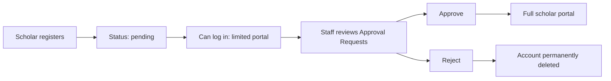
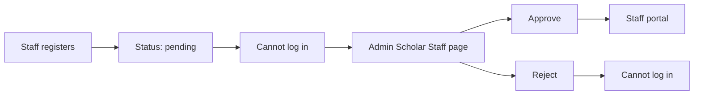
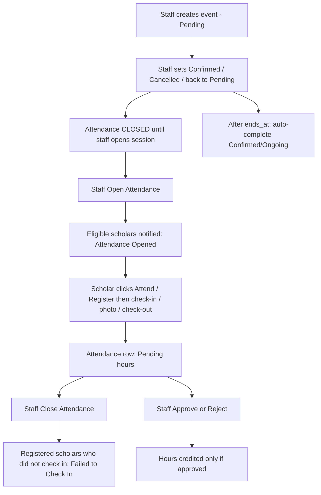
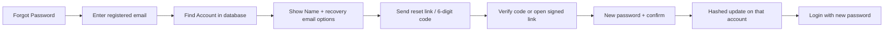
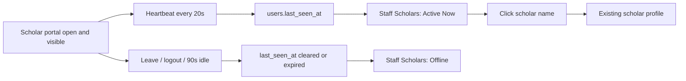

# Batang Surigaonon Scholar's App (BSSA)

<p align="center">
  
</p>

<h1 align="center">Batang Surigaonon Scholar's App</h1>

<p align="center">
  
  
  
  
</p>

A Laravel **web** application for managing the **Batang Surigaonon scholarship program**. It connects **scholars**, **scholar staff**, and **system administrators** around events, attendance, service hours, documents, approvals, and location-scoped scholarship programs (city vs province).

This README describes the **current codebase** in this repository. It is written from the routes, controllers, models, migrations, seeders, views, CSS, and configuration files that exist today.

**Start here for stack / thesis defense:** [§0 Technical stack and architecture reference](#0-technical-stack-and-architecture-reference) (frontend, backend, database, auth, architecture, packages, tools, role features, integrations, install, security, testing).

It has two jobs:

1. **Technical documentation** for the live Laravel web system (every existing function, rule, and stylesheet).
2. **Conversion reference** for a future **React Native + Expo / Expo Go** mobile client that must keep **all** of those functions, workflows, permissions, and the **same CSS visual identity** — only the presentation layer changes. *(Planned only — not implemented in this repo.)*

The visual language below is taken from the live stylesheets — not a new theme.

<table>
  <tr>
    <td width="33%" bgcolor="#e7f7ef" valign="top">
      <p><strong>Scholar</strong> &nbsp; <code>/user</code></p>
      <p>Sidebar <code>#e7f7ef</code> → <code>#eaf9ef</code><br />
      Active / buttons <code>#2fa76a</code><br />
      Page <code>#f6f8fb</code> · cards white, 12px<br />
      Typeface Inter · <code>styles.css</code></p>
    </td>
    <td width="33%" bgcolor="#e8f4fc" valign="top">
      <p><strong>Scholar Staff</strong> &nbsp; <code>/staff</code></p>
      <p>Sidebar <code>#e8f4fc</code> → <code>#eef8ff</code><br />
      Active / buttons <code>#1890ff</code><br />
      Page <code>#f0f4f8</code> · cards white<br />
      <code>staff-admin.css</code></p>
    </td>
    <td width="34%" bgcolor="#fff2f1" valign="top">
      <p><strong>Admin</strong> &nbsp; <code>/admin</code></p>
      <p>Sidebar <code>#fff2f1</code><br />
      Active / buttons <code>#c2410c</code><br />
      Page <code>#faf6f5</code> · shared staff cards<br />
      <code>admin.css</code></p>
    </td>
  </tr>
</table>

---

## Table of contents

**Technical reference (stack, architecture, setup)**

0. [Technical stack and architecture reference](#0-technical-stack-and-architecture-reference) — overview, frontend, backend, database, auth, architecture, packages, tools, role features, integrations, install, security, testing

**Detailed product documentation**

1. [Project overview](#1-project-overview)
2. [What problem it solves](#2-what-problem-it-solves)
3. [User roles and permissions](#3-user-roles-and-permissions)
4. [System workflows](#4-system-workflows)
5. [Authentication and authorization](#5-authentication-and-authorization)
6. [Features by portal](#6-features-by-portal)
7. [Notifications](#7-notifications)
8. [Backend architecture](#8-backend-architecture)
9. [Frontend architecture](#9-frontend-architecture)
10. [Visual identity (existing CSS)](#10-visual-identity-existing-css)
11. [Database](#11-database)
12. [Routes](#12-routes)
13. [Project structure](#13-project-structure)
14. [Technologies, languages, and packages](#14-technologies-languages-and-packages)
15. [System requirements](#15-system-requirements)
16. [Installation and setup](#16-installation-and-setup)
17. [Environment configuration](#17-environment-configuration) (includes [Gmail SMTP](#171-gmail-smtp))
18. [Database setup](#18-database-setup)
19. [How to run the application](#19-how-to-run-the-application)
20. [Build and production notes](#20-build-and-production-notes)
21. [Seeded administrator account](#21-seeded-administrator-account)
22. [Security features](#22-security-features)
23. [Validation and error handling](#23-validation-and-error-handling)
24. [Troubleshooting](#24-troubleshooting)
25. [Development guide](#25-development-guide)
26. [Complete function catalog](#26-complete-function-catalog)
27. [CSS files and UI component map](#27-css-files-and-ui-component-map)
28. [Expo Go / React Native conversion](#28-expo-go--react-native-conversion) *(planned — not implemented in this repo)*
29. [CSS to React Native style translation](#29-css-to-react-native-style-translation) *(planned)*
30. [Mobile UI adaptation](#30-mobile-ui-adaptation) *(planned)*
31. [Laravel API for the mobile client](#31-laravel-api-for-the-mobile-client) *(planned — no versioned REST API today)*
32. [Scholarship program isolation](#32-scholarship-program-isolation)
33. [Academic year and period management](#33-academic-year-and-period-management)
34. [Local file storage](#34-local-file-storage)
35. [Event lifecycle statuses](#35-event-lifecycle-statuses)
36. [Recent verified changes](#36-recent-verified-changes)
37. [Current interface and workflow updates](#37-current-interface-and-workflow-updates)

---

## 0. Technical stack and architecture reference

This section is the **complete technical reference** for evaluators and developers. It documents only technologies and features that exist in the current repository (`composer.json`, `package.json`, `.env.example`, `app/`, `resources/`, `database/`, `routes/web.php`, `tests/`). Deeper detail lives in the numbered sections below.

### 0.1 Project overview

**Batang Surigaonon Scholar’s App (BSSA)** is a **Laravel 12 web application** that manages scholarship operations for the Batang Surigaonon program. It connects three roles—**Scholars**, **Scholar Staff**, and **Administrators**—around events, attendance, service hours (30 required per semester), documents, approvals, announcements, academic years, and location-scoped scholarship programs/clubs.

| Portal | URL prefix | Layout / CSS |
|--------|------------|--------------|
| Scholar | `/user` | `layouts.user` · `resources/css/styles.css` (green) |
| Scholar Staff | `/staff` | `layouts.staff` · `public/css/staff-admin.css` (blue) |
| Administrator | `/admin` | `layouts.admin` · `staff-admin.css` + `public/css/admin.css` (orange) |

The product code lives under `app/`, `resources/views/`, `database/`, and `routes/web.php`. The Composer package name is still `laravel/laravel`. **There is no React Native / Expo app and no versioned public REST API in this repository** ([§28](#28-expo-go--react-native-conversion)–[§31](#31-laravel-api-for-the-mobile-client) describe a *planned* mobile client only).

### 0.2 Frontend technologies

| Layer | Actually used |
|-------|----------------|
| **Templates** | Laravel **Blade** (`resources/views/`: `layouts/`, `auth/`, `user/`, `staff/`, `admin/`, `partials/`, `mail/`, `components/`) |
| **HTML / CSS / JS** | Server-rendered HTML; custom CSS (not a React/Vue SPA) |
| **Scholar CSS** | `resources/css/styles.css` (Vite) + page CSS under `public/css/` (`user-nav.css`, `documents-page.css`, `service-hours-page.css`, `notifications-page.css`, `profile-page.css`, `dashboard-events.css`, `attendance-photo.css`, `pending-approval-modal.css`) |
| **Staff / Admin CSS** | `public/css/staff-admin.css`, `public/css/admin.css` (loaded with `?v=filemtime`) |
| **Build** | **Vite 7** + `laravel-vite-plugin` (`vite.config.js`). Inputs: `resources/css/styles.css`, `resources/js/app.js`, `resources/js/user-app.js` |
| **Tailwind CSS v4** | Still listed in `package.json` / Vite plugin config for optional utility CSS; **product UI for the three portals is custom CSS** (`styles.css`, `staff-admin.css`, `admin.css`). The old Laravel `welcome` + `app.css` Vite entry were removed as unused |
| **JS** | `resources/js/user-app.js` (sidebar, attendance poll ~12s, scholar presence ~20s, staff presence poll ~10s, avatar preview); `resources/js/app.js`; `public/js/notifications-toggle.js`; some inline Blade scripts |
| **HTTP client** | `axios` (npm) available via the Vite bundle |
| **Fonts** | **Inter** via Google Fonts in `layouts/app.blade.php` |
| **Charts** | CSS `conic-gradient` pie charts (no Chart.js) — admin reports + Overall Reports card |

**Not used for the product UI:** React, Vue, Alpine.js, Livewire, Inertia (not in `composer.json` / `package.json`).

### 0.3 Backend technologies

| Layer | Implementation |
|-------|----------------|
| **Language** | **PHP ^8.2** |
| **Framework** | **Laravel 12** (`laravel/framework ^12.0`) |
| **Architecture** | Classic **MVC + service layer**: routes → controllers → services/models → Blade responses |
| **Routing** | `routes/web.php` only (no `routes/api.php`). Health: `GET /up` |
| **Controllers** | `app/Http/Controllers/` (e.g. `AuthController`, `PasswordResetController`, `UserController`, `StaffController`, `AdminController`, `EventActionController`, `DocumentActionController`, …) |
| **Models** | Eloquent under `app/Models/` (see [§0.4](#04-database) and [§8](#8-backend-architecture)) |
| **Services** | Domain logic in `app/Services/` (`ScholarService`, `StaffDashboardService`, `AdminDashboardService`, `PasswordResetService`, `DocumentStorageService`, `LocalArchive`, …) |
| **Middleware** | Aliases in `bootstrap/app.php`: `scholar`, `scholar.approved`, `scholar.staff`, `scholar.staff.approved`, `admin`; global web append `EnsureAccountAccess` |
| **Support** | `app/Support/` (e.g. `CourseCatalog`, `PhilippineIslandGroup`, `MissingResourceRedirect`, `OutboundAppUrl`) |
| **Mail** | Laravel Mail + Gmail SMTP. Password reset (`PasswordResetCodeMail`), admin backup-email verification, and workflow notices (`WorkflowNotificationMail` via `WorkflowMailService`). Sent immediately, not through a queue worker |
| **Queues / cache / sessions** | Database drivers by default (`.env.example`) |
| **CLI** | `artisan` commands (e.g. `mail:inspect`, `app:reset-operational-data`) |

### 0.4 Database

| Item | Detail |
|------|--------|
| **Default DBMS** | **SQLite** (`DB_CONNECTION=sqlite` in `.env.example`). MySQL/MariaDB supported by changing `.env` |
| **ORM** | Laravel Eloquent |
| **Schema** | Migrations under `database/migrations/` |
| **Seeders** | `DatabaseSeeder` → `ScholarshipProgramSeeder` (PSGC JSON import) + `AdminSeeder` + active `academic_settings` row |
| **Factories** | `database/factories/UserFactory.php` (tests) |

**Core tables (implemented):** `users`, `password_reset_tokens`, `sessions`, `cache` / `cache_locks`, `jobs` / `job_batches` / `failed_jobs`, `scholarship_programs`, `scholarship_clubs`, `scholarship_club_schools`, `events`, `event_registrations`, `attendances`, `attendance_session_logs`, `attendance_day_sessions` (older per-day rows; current open/close does not write them), `document_types`, `documents`, `document_revisions`, `announcements`, `announcement_reads`, `scholar_notifications`, `user_activities`, `academic_settings`, `admin_backup_emails`, `scholar_suspensions`. Older `google_drive_folders` and `google_drive_connections` tables may still exist from a previous migration. The application no longer reads or writes them.

**Eloquent models:** `User`, `ScholarshipProgram`, `ScholarshipClub`, `ScholarshipClubSchool`, `Event`, `EventRegistration`, `Attendance`, `AttendanceSessionLog`, `Document`, `DocumentRevision`, `DocumentType`, `Announcement`, `AnnouncementRead`, `ScholarNotification`, `UserActivity`, `AcademicSetting`, `AdminBackupEmail`, `ScholarSuspension`.

High-level relationships and field notes: [§11](#11-database).

### 0.5 Authentication and authorization

| Concern | Implementation |
|---------|----------------|
| **Login** | Email + password (`AuthController`); session auth (Laravel guard `web`) |
| **Remember-me** | Extended duration configured in `AppServiceProvider` |
| **Roles** | `users.role` + `is_admin` — scholar, scholar staff, administrator |
| **Login gate** | `User::canLogin()` — pending scholars and pending staff may sign in to a restricted page; suspended and blocked accounts cannot; inactive staff cannot; administrators can when the password matches |
| **Portal middleware** | `scholar` / `scholar.approved` / `scholar.staff` / `scholar.staff.approved` / `admin` |
| **Account blocks** | `EnsureAccountAccess` (suspensions / blocked accounts) |
| **Registration** | Scholar `/register`; staff `/register/staff` (pending until admin approval) |
| **Password reset** | Find Account → recovery email options from DB → Gmail SMTP 6-digit code / signed link → verify → new password ([§4.5](#45-forgot-password-scholar-scholar-staff-and-administrator)) |
| **Admin backup emails** | Verified backups usable for admin recovery (`AdminBackupEmail`) |
| **Email verification (Laravel)** | **Not used** for scholars — routes removed; login follows `status` |

Details: [§5](#5-authentication-and-authorization), [§22](#22-security-features).

### 0.6 System architecture

```text
Browser (Blade UI + Vite assets)
    │  HTTPS/HTTP form posts, occasional JSON XHR
    ▼
Laravel HTTP kernel (web middleware + role aliases)
    │
    ├─ Controllers  ──► Services  ──► Eloquent Models  ──► SQLite/MySQL
    │                      │
    │                      ├─ Mail (Gmail SMTP) ──► scholar/staff/admin inboxes
    │                      └─ Storage public disk ──► storage/app/public
    │
    └─ Blade views + public/css + Vite JS
```

- **Request flow:** `routes/web.php` → middleware → controller → service/model → Blade (or redirect/JSON).
- **Files:** Laravel `public` disk at `storage/app/public`, served through `public/storage` after `php artisan storage:link`. Folder layout is in [§34](#34-local-file-storage).
- **Background:** `QUEUE_CONNECTION=database`. Password reset and workflow emails are sent in the request. Closing attendance finishes missed check-ins in a queued follow-up, so `php artisan queue:listen` (included in `composer dev`) should be running for that step. `routes/console.php` schedules expired-suspension release every 15 minutes and `events:complete-expired` every minute; those need `php artisan schedule:work` or a system cron entry for `schedule:run`.
- **No separate frontend server in production** — `npm run build` emits assets Laravel serves; local `npm run dev` is Vite HMR only.

### 0.7 Libraries and dependencies

**Composer (production):** `laravel/framework`, `laravel/tinker`.

**Composer (dev):** `phpunit/phpunit`, `fakerphp/faker`, `mockery/mockery`, `nunomaduro/collision`, `laravel/pint`, `laravel/sail`, `laravel/pail`.

**npm (devDependencies):** `vite`, `laravel-vite-plugin`, `tailwindcss`, `@tailwindcss/vite`, `axios`, `concurrently`.

Full tables: [§14](#14-technologies-languages-and-packages).

### 0.8 Development tools and environment

| Tool | Role in this project |
|------|----------------------|
| **PHP 8.2+** | Runtime |
| **Composer 2** | PHP deps; scripts `setup`, `dev`, `test` |
| **Node.js + npm** | Vite build / dev server |
| **Vite 7** | Asset bundling (`npm run build` / `npm run dev`) |
| **SQLite** (default) or MySQL | Database |
| **PHPUnit 11** | Feature/unit tests (`php artisan test` / `composer test`) |
| **Laravel Pint** | Code style (dev) |
| **Laravel Sail** | Optional Docker tooling (dev dependency; not required for local SQLite) |
| **Laravel Pail** | Log tailing in `composer dev` |
| **Artisan serve** | Local HTTP (`php artisan serve --host=0.0.0.0 --port=8000`) |

Timezone default: `Asia/Manila` (`.env.example`).

### 0.9 Core features by user role

| Role | Implemented capabilities (summary) |
|------|-------------------------------------|
| **Scholar** | Dashboard, events/register/check-in/out + photo, calendar, service hours, documents upload/view/download, notifications, profile/settings, security shortcuts (academic settings, password, login credentials), announcements (incl. pending), presence heartbeat; pending accounts limited until approval |
| **Scholar Staff** | Dashboard, scholars (approve/reject/view), events CRUD + attendance sessions + status workflow, documents review, approval requests, calendar, settings (club/schools), four report pages (service hours, attendance, participation, completion) |
| **Administrator** | Dashboard (location filters, viewing academic year, Overall Reports pie, Events completed card), scholars/staff/events/service hours/documents directories, regional reports (Luzon/Visayas/Mindanao pies), admin settings (profile, password, backup emails, academic years), staff approve/reject/block/suspend/delete |

Full portal matrices: [§3](#3-user-roles-and-permissions), [§6](#6-features-by-portal).

### 0.10 Integrations and file storage

| Integration | Status | Notes |
|-------------|--------|-------|
| **Gmail SMTP** | Implemented | Forgot Password codes / reset mail; backup-email verification |
| **Local public disk** | Implemented | Documents, attendance photos, and event images under `storage/app/public` ([§34](#34-local-file-storage)) |
| **PSGC locations** | Implemented | `database/data/psgc-locations.json` imported by seeder |
| **ui-avatars.com** | Used in some UI placeholders | External avatar image URLs |
| **Versioned mobile API** | **Not implemented** | Web routes + a few JSON XHR endpoints only |

File layout: [§34](#34-local-file-storage).

### 0.11 Installation and setup

From the app root (folder containing `artisan`):

```bash
composer install
copy .env.example .env          # macOS/Linux: cp .env.example .env
php artisan key:generate
# Ensure database/database.sqlite exists when using SQLite
php artisan migrate --force
php artisan db:seed
php artisan storage:link
npm install
npm run build
php artisan serve --host=0.0.0.0 --port=8000
```

Or: `composer setup` (install, `.env`, key, migrate, npm install + build) then run `db:seed`, `storage:link`, and serve separately.

Configure `MAIL_*` in `.env` ([§17](#17-environment-configuration)). Uploaded files need `php artisan storage:link` and a writable `storage/app/public` directory. Seeded admin: [§21](#21-seeded-administrator-account).

### 0.12 Security and validation

| Area | Implemented behavior |
|------|----------------------|
| **Passwords** | Eloquent `hashed` cast; `Password::min(8)` on register/reset; `User::updatePassword()` |
| **CSRF** | Laravel web middleware on form posts |
| **Authorization** | Role middleware + ownership checks (e.g. document owner-only view/download) |
| **Uploads** | Size/type validation; `PostTooLargeException` → friendly message; files stay on the Laravel `public` disk |
| **Password reset** | Hashed one-time codes, expiry, attempt limits, rate limiting; no password/hash exposure in UI |
| **Mass assignment** | Sensitive flags (`is_permanent`, `last_seen_at`, `events_visible_from`) not freely fillable |

Details: [§22](#22-security-features), [§23](#23-validation-and-error-handling).

### 0.13 Testing and troubleshooting

**Run tests:**

```bash
php artisan test
# or
composer test
```

**Feature tests** live under `tests/Feature/` (40+ files), including password reset, local document and attendance storage, admin filters/reports, event status workflow, sidebar layout, account access, academic year settings, and more.

**Common issues:** SMTP App Password / `config:clear`; Vite LAN host (`VITE_DEV_HOST`); missing `storage:link`; SQLite file missing. Full list: [§24](#24-troubleshooting).

---

## 1. Project overview

**Name in the UI:** Batang Surigaonon Scholar's App  
**Code location:** this Laravel application (`composer.json` name is `laravel/laravel`; the product logic lives under `app/`, `resources/views/`, and `database/`).

The system is a **role-based scholar portal** with three portals:

| Portal | URL prefix | Who uses it |
|--------|------------|-------------|
| Scholar (user) | `/user` | Approved and pending scholars |
| Scholar Staff | `/staff` | Approved scholar staff assigned to a scholarship program |
| Administrator | `/admin` | System administrators |

The root URL `/` redirects to the login page. After login, users are sent to the dashboard that matches their role.

City and province programs are stored as separate `scholarship_programs` rows (`location_type`). Staff queries stay program-scoped. **Admin list pages** (Scholars, Staff, Events, Service Hours, Documents) use geographic filters—**Region** (where applicable), **Province**, **Municipality/City**, and **Scholarship Club**—not a City Scholar / Province Scholar “program type” switch on the Admin Dashboard. The **Admin Dashboard** uses Province and Municipality/City only (plus Overall Reports system-wide pie). Selecting a location limits clubs and records to that geography; empty locations show **0** / empty states. Scope still uses `scholarship_program_id` (and club IDs when filtered). See [§6.4](#64-admin-portal-admin) and [§32](#32-scholarship-program-isolation).

Required service hours for scholars: **30 per semester** (`ScholarService::REQUIRED_HOURS`). Approved hours are credited to the attendance row’s academic year and semester. Pending hours are not completed hours. Extra approved hours above 30 in a semester are carried into the next semester (`ScholarService::allocateHoursFromRecords`); they do not raise that semester’s completed total above 30. Staff → Scholar profile shows the current semester summary plus a 4-year progress grid from `ScholarService::programHourTracking`.

There is **no Expo / React Native app in this repository yet**. The web Laravel app remains the source of truth. A future mobile client must call this backend and reuse the existing CSS tokens ([§10](#10-visual-identity-existing-css), [§28](#28-expo-go--react-native-conversion)). For a concise stack map, see [§0](#0-technical-stack-and-architecture-reference).

---

## 2. What problem it solves

The application supports day-to-day scholarship operations:

- Register scholars and scholar staff against a **specific city or province program** and a staff-created **Scholarship Club**.
- Approve or reject new accounts before they get full access.
- Publish **events**, collect **participation**, and control **attendance sessions** (open/close).
- Collect **check-in / check-out** and a **participation photo**.
- Credit **service hours** after staff approval.
- Require and review **documents** by program-specific document types.
- Track **academic year / semester** for hours and reports.
- Give administrators a **system-wide view** filtered by location and program.
- Let scholar staff see which of their program’s scholars are **currently using** the scholar portal (**Active Now**), and open a scholar’s full profile by clicking the name.

---

## 3. User roles and permissions

Roles are stored on `users.role` (`App\Models\User`):

| Constant | Value | Meaning |
|----------|--------|---------|
| `ROLE_SCHOLAR` | `scholar` | Scholar / regular user |
| `ROLE_SCHOLAR_STAFF` | `scholar_staff` | Scholar staff |
| `ROLE_ADMIN` | `admin` | Administrator |

`users.is_admin` is also used; `User::isAdmin()` is true when `is_admin` is true **or** `role` is `admin`.

Scholars, scholar staff, and administrators all live in the **same** `users` table. They are separated by `role`, not by separate databases or user tables. Numeric `users.id` values are one shared sequence.

`users.is_permanent` marks the designated administrator. `User::isPermanentAdmin()` is true when `is_permanent` is true, or when the email is `User::PERMANENT_ADMIN_EMAIL` (`batangsurigaononscholarsapp@gmail.com`), or when `scholar_id` is `ADMIN-001`. `AdminSeeder` still recognizes the legacy address `bssa_admin@gmail.com` when locating an existing row and migrates it to the canonical permanent email.

Account status (`users.status`):

| Constant | Value | Typical use |
|----------|--------|-------------|
| `STATUS_PENDING` | `pending` | Waiting for approval |
| `STATUS_APPROVED` | `approved` | Active |
| `STATUS_REJECTED` | `rejected` | Denied |
| `STATUS_INACTIVE` | `inactive` | Scholar staff deactivated by admin; record kept, login blocked |
| `STATUS_BLOCKED` | `blocked` | Access blocked (`EnsureAccountAccess`) |
| `STATUS_SUSPENDED` | `suspended` | Temporary suspension with scheduled release |

### 3.1 Scholar

- **Can log in** unless status is `rejected`.
- **Pending scholars** can open Dashboard, Announcements (list + show + mark read), and Logout. They also send a presence heartbeat (`POST /user/presence`) while the scholar portal is open. Events, Calendar, Service Hours, Documents, Notifications, and Profile are blocked until staff approval (`EnsureScholarApproved` and sidebar `is-disabled` items). Announcements are **not** a sidebar item; they are opened from the dashboard and `/user/announcements`.
- **Approved scholars** get the full scholar portal listed in [§6.2](#62-scholar-portal-user), including the same presence heartbeat.
- Scholars can only see events, announcements, document types, and hours for their assigned `scholarship_program_id` (`visibleLocationIds()` / `assertEventVisibleToUser`). Scholar event lists use `Event::scopeVisibleToAccount`: an event stays visible when its **`ends_at` is on or after** `User::eventsVisibleFrom()` (`events_visible_from` on approval, otherwise `created_at`). Creation time alone does **not** hide an upcoming/ongoing event that staff published shortly before the scholar was approved. Staff lists still gate on **`created_at >= events_visible_from`**. Fresh scholar calendars also use `scopeUpcomingForFreshScholar` (date window). Event rows are not deleted.
- Scholars **cannot** register or mark attendance for events whose lifecycle status is **Pending**, **Cancelled**, or **Completed**. Registration and attendance are allowed only for **Confirmed** / **Ongoing** events, and check-in/out/photo only while staff have opened attendance (`Event::allowsScholarRegistration()`, `allowsScholarAttendanceActions()`, enforced in `EventActionController` and the Events UI). See [§35](#35-event-lifecycle-statuses).
- Scholars **cannot edit or delete** submitted attendance records. On the event Attendance card, **Attach Photo** comes first and **Check Out** sits directly under it.
- Must **register** for the event before check-in. Check-in is blocked if the event has ended **and** attendance is closed.
- Attendance status shown to scholars: **Pending**, **Approved**, **Rejected**, and **Failed to Check In** when applied.
- Scholars cannot approve their own hours. `POST /user/attendances/{attendance}/approve` exists but **aborts 403 unless the user is an administrator**.
- **Email verification is not required.** Scholar `verification.*` routes are removed; an unverified scholar can log in and use the portal according to account status (`EmailVerificationTest`).

### 3.2 Scholar staff

- Registration starts as **pending**. Pending scholars may log in to a **restricted user dashboard** (profile view + pending status); Events/Documents/Attendance stay locked until approval (`scholar.approved`). Pending staff may log in only to `/staff/pending-approval`. Rejected and inactive accounts still cannot use protected portals.
- **Only administrators** see pending staff registrations and can Approve or Reject them. On the staff list, **More** can Activate, Deactivate (`inactive`), or Delete an existing (non-pending) staff account.
- Pending staff **do not appear** in “All Scholar Staff Accounts” and are not counted as active staff.
- After approval, staff can manage **only their assigned program** (`managedLocationIds()` / `coveredLocationIds()`, which is that program’s own ID — never city+province mixed).
- Staff can approve/reject **scholars**, set a scholar’s **Start Academic Year** (`program_start_year` via `PUT /staff/scholars/{scholar}/program-start`), create events, change event lifecycle status (`PATCH /staff/events/{event}/status`: Pending / Confirmed / Cancelled; Completed is schedule-driven), open/close attendance, approve/reject attendance hours, view attendance photos, manage document types and reviews, and run the four report pages for their program.
- On **Scholars**, staff open a scholar’s existing profile by **clicking the scholar name** (`.staff-scholar-name-link` → `GET /staff/scholars/{scholar}`). That list has no eye/view column. The profile is view-only except the existing pending **Approve** / **Reject** actions. Staff still only see scholars in their assigned program (`canManageScholar`).
- Staff **Active Now** / **Offline** on Scholars (and the scholar profile) uses `users.last_seen_at` for that program only. It is not “approved” and not `last_login_at`.
- A staff account’s **Events**, **Calendar**, **Attendance** event picker, and dashboard upcoming-event counts only include events created at or after `User::staffEventsVisibleFrom()` (`events_visible_from` when set, otherwise the staff `created_at`). Older program events stay in the `events` table for other staff, scholars, reports, and admin. `Event::scopeVisibleToStaff` applies the filter; `User::canViewStaffManagedEvent` blocks show/attendance on hidden events.
- Staff **cannot** approve other staff accounts, cannot open another program’s events (`403` on `showEvent`), and cannot review document types outside their program (`ProgramScopeService::assertDocumentTypeManagedByStaff`).
- Pending staff who pass login are sent to `GET /staff/pending-approval`. `EnsureScholarStaff` allows that page and `POST /staff/dismiss-pending-modal`, and redirects every other staff URL back there until an administrator approves the account. Rejected and inactive staff are logged out.

### 3.3 Administrator

- Full `/admin` portal (`EnsureAdmin`).
- Can filter most admin pages by location. **Admin → Scholars**, **Scholar Staff**, **Events**, **Service Hours**, and **Documents** do not use a City Scholar / Province Scholar split: they list records with **Region** (All Regions / Luzon / Visayas / Mindanao), Province, Municipality/City, and **Scholarship Club** filters. Selecting a club fills Province and Municipality/City from the club’s stored address. No admin page shows the **📍 City Scholar — All Locations** location pill (or any replacement location chip) in the header. **Admin Settings** has neither the Viewing form nor the **Current Admin Scope** banner. **Reports** has neither the Viewing form nor the scope banner; it uses an **Academic Year** dropdown and always shows Luzon, Visayas, and Mindanao together. The **Admin Dashboard** uses Province and Municipality/City only (no scope banner, no Scholarship category, no Scholarship Clubs list) and includes the Viewing Academic Year selector with the “Showing Administration data for” banner. There is **no Admin Locations page**.
- Approves or rejects **scholar staff** only (not scholar accounts — those are staff’s job).
- On a staff detail page, can set **Started Year** (`users.staff_started_year` via `PUT /admin/staff/{staffMember}/started-year`). Started Year is **not** collected on staff registration.
- Manages **backup emails** for admin password recovery (add / update / resend verification / delete; signed verify link `GET /backup-email/verify/{backupEmail}`).
- Can view scholars (click name for a view-only profile), events (click title for attendees), service hours, documents (click scholar name to preview/download that scholar’s files), and reports.
- There is **no** Admin Participation page, **no** Admin Attendance page, and **no** Admin Locations page. Staff still own participation reports and attendance sessions.
- Can update their own name, email, and password.
- Admin scholars list is **read-only** (search by name, email, scholar ID). Admin does **not** approve scholar accounts.
- The designated Admin account is **permanent** and cannot be deleted through the application.
- `AnnouncementService::publish()` exists for program-scoped notices, but **no staff or admin create-announcement route is wired** in `web.php`. Scholars can only list/read announcements that already exist.

---

## 4. System workflows

### 4.1 Scholar registration and approval



1. Scholar submits `/register` with name, scholar ID, email, password, a **Scholarship Club** (`scholarship_club_id`) created by Scholar Staff, a **School/University** from that club’s list (`scholarship_club_school_id`), an optional **Course** typed as the complete official name (stored on `users.course_year_level`), and an optional **Year Level** (`CourseCatalog::yearLevels()`, stored on `users.year_level`). Course is a fillable text field. Initials such as BSICT, BSCE, or BSIS are rejected; the scholar enters the full name (for example Bachelor of Science in Information Technology). Year Level options are 1st Year, 2nd Year, 3rd Year, and 4th Year. Both values are saved on the scholar account and stay editable in User Settings / Profile Information (Course as a text field, Year Level as the same 1st–4th Year dropdown, School as the current staff-managed list). Selecting a club automatically shows that club’s saved Province and Municipality/City and the School/University names added in Staff Settings; the scholar cannot edit the address. The club, school, and address are stored on the scholar (`users.scholarship_club_id`, `users.scholarship_club_school_id`, `users.school_university`, `users.city`, `users.province`, and the club’s location program on `users.scholarship_program_id`). After approval, only staff of that club can manage the scholar. **Batang Surigaonon Scholars Club** is not a selectable Scholarship Club for scholars, staff, or administrators (see [§4.2](#42-scholar-staff-registration-and-approval)).
2. `User::register()` creates the account; `AccountService::provisionNewAccount()` creates document placeholders and a pending-approval notification.
3. Staff on the same Scholarship Club see the scholar under **Approval Requests** and **Scholars**. On **Scholars**, the name opens the scholar profile; Approval Requests still uses its view / approve / reject action buttons.
4. **Approve** sets status to `approved`, calls `User::activateFreshEventList()` (sets `events_visible_from` if null), and notifies the scholar. That scholar’s Events/Calendar then include program events that had **not already ended** before activation (see [§3.1](#31-scholar)).
5. **Reject** permanently deletes the pending scholar via `AccountService::permanentlyDelete` (same cleanup as Delete), releasing email and scholar ID for a new registration. **Delete Account** on an approved/blocked/suspended scholar profile does the same permanent removal. Leftover rejected rows from older behavior are purged automatically when the same email or scholar ID registers again. Remaining `users.id` values are compacted (`UserSequenceService`). The designated Admin account is never deleted.

### 4.2 Scholar staff registration and approval



1. Staff submits `/register/staff` with a typed **Scholarship Club Name**, the official **Province** and **Municipality/City** of the club, and a required **Contact Number**. There is no Scholar Staff Number field. Club values are stored on `scholarship_clubs` (`name`, `province`, `city`, and the matching city program) and linked to the staff account (`users.scholarship_club_id`). Contact Number is stored on `users.cellphone_number`. An internal unique `users.scholar_id` (`STAFF-{ULID}`) is generated for the database only and is not shown on staff registration, Admin Staff, or Staff Settings. Staff can edit the club name, address, and contact number in `/staff/settings`. Any valid club name is allowed, but a name is reserved only while an existing Scholar Staff account owns that club (`scholarship_clubs.name_key`, case-insensitive and trimmed). Duplicate attempts show a single alert: “This Scholarship Club name is already registered. Please use a different name.” Orphaned club rows with no staff owner are purged and do not block registration. When the owning Scholar Staff account is permanently deleted and no other staff still owns the club, the club row is removed and the name becomes available again. Other staff accounts, their clubs, and scholar user records are preserved (scholars are only unlinked from a released club).
2. Account is `scholar_staff` + `pending`. The administrator Scholar Staff list and sidebar badge show the pending account. When SMTP is ready, `WorkflowMailService` also emails administrators (`New scholar staff registration`). In-app notice to the new staff account is still saved if that email fails.
3. Other staff never see pending staff details.
4. Admin **Approve** sets `approved` and calls `User::activateFreshStaffEventList()` (sets `events_visible_from` to now if it is still null). Admin **Reject** permanently deletes the pending account (`AccountService::permanentlyDelete`), releasing the email and any sole-owned Scholarship Club name so the applicant can register again.
5. On **All Scholar Staff Accounts**, **More** can **Activate** (`approved`), **Deactivate** (`inactive`, login blocked, record kept), or **Delete** (permanent `AccountService::permanentlyDelete`, same identifier/club-name release rules as Reject). Deactivate and Delete ask for confirmation first.
6. That new staff account starts with an empty Events list until an event is created after they became active. Existing staff whose `created_at` is earlier than those events still see the full program history. Event rows are not deleted.

### 4.3 Event, attendance, and service hours



- New events start as **`pending`** with **attendance closed** and **zero registrations**. Creating an event does not check scholars in, open attendance, or copy another event’s participation. Schedule times do **not** auto-open attendance. A scholar is registered only after they click **Attend / Register** on a Confirmed or Ongoing event.
- Staff can change lifecycle status with the Events table dropdown (`PATCH /staff/events/{event}/status`): **Pending**, **Confirmed**, **Cancelled**. **Completed** is applied by `events:complete-expired` / `Event::completeExpiredConfirmedIds` after `ends_at` for confirmed/ongoing events (pending and cancelled are never auto-completed). Cancelled events can be hard-deleted (`staff.events.destroy`); other statuses cannot.
- **Scholars** may Attend / Register only when status is Confirmed or Ongoing and the event is still open for registration. Pending shows: *“Registration is unavailable because this event is pending approval. Please wait until the event is confirmed.”* Cancelled and Completed also block new registration and attendance. Backend endpoints reject unauthorized posts even if the UI is bypassed (`EventStatusWorkflowTest`).
- Staff Events (`GET /staff/events`) lists only events visible to that staff account (`visibleToStaff`). The empty table reads **No events found.** **+ Add Event** stays on the filter bar.
- Staff **Open Attendance** / **Close Attendance** control one session for the whole event. They write `attendance_is_open`, the actual opening or closing time, the actor, and an `attendance_session_logs` row (`session_date` null), and they notify scholars. They do not create `attendance_day_sessions` rows. Reopening does not clear the previous closing time; the session counts as closed only while `attendance_is_open` is false and `attendance_closed_at` is set. Closing a session that is already closed does nothing. Opening a session that is already open is rejected.
- Scholars may check in, attach a photo, or check out only when the event is Confirmed or Ongoing, `attendance_is_open` is true, and the current time is between `starts_at` and `ends_at` inclusive. OPEN/CLOSED badges follow the staff flag. Outside the schedule, an open session still shows OPEN and the submit action explains that attendance can be submitted only during the scheduled time. Pending, Cancelled, and Completed block submission. One `attendances` row exists per scholar and event.
- Staff approve or reject hours. Scholars see **Pending / Approved / Rejected**. Staff no longer have a free-form “Edit Attendance Record” form.
- When Scholar Staff (or an administrator) **verifies/approves** attendance, `AttendanceArchiveService` copies that scholar’s photo into `bssa/attendance/...` on the public disk ([§34](#34-local-file-storage)). The original upload is left in place. Pending, rejected, and failed-to-check-in photos stay at the path where they were uploaded and are not mixed into the documents tree.
- Live status for scholars: `GET /user/attendance-status` polled about every 12 seconds (`resources/js/user-app.js`).
- Confirmed → Pending / Cancelled / Completed status changes notify approved scholars in the program (`ScholarService::notifyScholarsOfEventStatusChange`, deduped by user + event + title).

### 4.4 Documents

1. Approved Scholar Staff define **document types** for their scholarship program (`StaffDocumentController`). Each type stores `required`, `submissions_open`, `submissions_opened_at`, `submissions_closed_at`, and an optional `submission_deadline` (`Asia/Manila`).
2. When a scholar is provisioned, placeholder `documents` rows are created (`ScholarService::ensureUserDocuments`). Creating or renaming a type does not delete existing files or review history.
3. **Open Submissions** and **Close Submissions** apply to one document type. The matching button is disabled for the current state. Closing blocks upload, replace, resubmit, and delete of that type in `DocumentActionController`. Other types stay unchanged. Previously uploaded files, review status, and notes stay visible.
4. A deadline in the past blocks uploads even if the manual status is still open, until staff extends or removes that deadline. If the deadline itself closed submissions and staff later sets a future deadline or clears it, submissions open again. A manual close before the deadline is not reopened by a name or description edit. `ScholarService::syncDocumentDeadlines` closes an open type whose deadline has passed and was not reopened after that deadline, and it notifies once.
5. Deadline reminders: within 24 hours of a deadline that still accepts submissions, scholars get one “Deadline approaching” notice. Passed, closed, reopened, extended, changed, removed, and newly set deadlines each notify once per scholar, title, and body. The scholar Documents page shows the deadline or **No deadline set**. It does not show a “Submissions are currently closed” banner; closure text is in Notifications.
6. Scholar upload is a PDF, JPG, or PNG up to 5MB. Not-submitted and pending files use the table **Upload** or **Replace** action, and only while that document type still accepts submissions (open, and the deadline has not passed). A **rejected** file is replaced from the table Action column with **Browse Files** and **Upload Replacement**. That replacement is allowed for the document owner even after the deadline or a deadline auto-close. It is not shown on the status card. Laravel stores the new file on the `public` disk under `bssa/documents/{AY YYYY–YYYY}/{Province}/{Municipality}/{scholar_id} – {full_name}/`. The previous rejected file is kept: `DocumentStorageService` copies its path, name, status, and review note into `document_revisions` and does not delete that file. The live `documents` row becomes `pending`, `uploaded_at` is the replacement time, and current review fields are cleared. Approved files cannot be replaced or deleted. Another scholar posting the same document type updates only their own row. A short cache lock blocks a second click while an upload is in progress. Attendance photos use `bssa/attendance/...` and are never stored in the documents tree. See [§34](#34-local-file-storage) and [§37](#37-current-interface-and-workflow-updates).
7. Staff review: approve, reject, or return to pending, with optional notes. View and download stream the file from the public disk. The submissions table can be filtered by school or university (including **No School Specified**), search, status, and document type. Counts follow the school filter. Admin Preview/Download uses the same stream. Admin does **not** change document status.
8. The scholar Documents page shows the overview, status cards, document table, guidelines, and help card. It does not show a STUDENT INFORMATION card or a cloud-storage connection message.

### 4.5 Forgot password (Scholar, Scholar Staff, and Administrator)



1. Login **Forgot Password?** opens `GET /forgot-password` (`?fresh=1` from the login link). A cold GET never restores a prior find: the controller clears find-session keys and `_old_input` email values, and the Blade template does **not** use `old('email')`. Only the empty registered-email input (placeholder: “Enter your registered email address”) and **Find Account** are rendered—no recovery markup in the HTML.
2. **Find Account** (`POST /forgot-password/find`) validates the email, looks up an eligible account (`PasswordResetService::findRecoveryAccount`), stores id / name / lookup email / recovery options in the session, and sets a one-time `password_reset_reveal` flash. Empty or invalid emails show validation errors with an empty field. Unknown emails show: “No account was found with the email address you entered.” with no recovery section and no prefills.
3. The recovery block (**Account found. Select a recovery email:**, **Name**, **Email**, options, **Send Reset Link**) is server-rendered only when that reveal flash is present on the redirect after a successful find. Refreshing or reopening `/forgot-password` without a new find clears the session and returns the blank form again. Editing the lookup email also clears prior results.
4. Eligible recovery targets: Scholar and Scholar Staff primary emails; Administrators may use the primary email or a **verified** backup email. Passwords, hashes, and reset tokens are never shown in the UI.
5. **Send Reset Link** is available only after a find and a selected recovery email. `PasswordResetService` generates one 6-digit code (`random_int`), stores **only its hash** on `password_reset_tokens`, and emails that code plus a signed reset link through Gmail SMTP (`PasswordResetCodeMail`). Success is shown only after SMTP delivery succeeds; if delivery fails, the token row is deleted and the user sees an error (never a false “sent” message).
6. Verifying the code (or opening the signed link) does **not** generate a new code. The value is compared with `Hash::check` against the stored hash.
7. Incorrect, expired (10 minutes), already-used, or locked-out codes cannot continue. After a successful verify the code is marked used (`used_at`).
8. New password rules match registration: `Password::min(8)`, confirmed. `User::updatePassword()` hashes via the existing `hashed` cast and updates **only** that account.
9. Success redirects to login with a confirmation message.

Mail uses Gmail SMTP from `config/mail.php` / `.env` (`MailConfigService`). If SMTP is not ready or Gmail rejects the message, the unused code row is deleted and the user sees a sanitized error (the App Password is never shown).

### 4.6 Scholar presence and staff scholar profile



1. A logged-in scholar (pending or approved) with the scholar portal **open and visible** posts `POST /user/presence` about every 20 seconds (`User::markPresence`). Hidden tabs skip the heartbeat.
2. Closing the tab, navigating away (`pagehide` + `POST /user/presence/leave`), or **Logout** clears `last_seen_at` (`User::clearPresence`). After 90 seconds without a heartbeat (`User::PRESENCE_SECONDS`) the scholar is **Offline**.
3. Staff → Scholars (`GET /staff/scholars`) shows a green-dot **Active Now** or **Offline** beside each name. The page polls `GET /staff/scholar-presence` about every 10 seconds for scholars in `StaffDashboardService::programIds()` only.
4. Clicking the scholar name is the **only** view action on that list. It opens the same profile the old eye button used (`GET /staff/scholars/{scholar}`, `canManageScholar`). There is no Actions / eye column on Scholars. Approval Requests, Events, and the staff dashboard pending list still use their existing action buttons.
5. Approved status and `last_login_at` never imply **Active Now**. No extra user accounts are created.

---

## 5. Authentication and authorization

### Login (`AuthController`)

- Email + password; email is lowercased.
- Remember-me duration is set to **10 years** (5,256,000 minutes) in `AppServiceProvider` so inactivity does not expire the account.
- After success, `last_login_at` is updated (`User::markLogin`). That timestamp is **not** used as live presence.
- While a scholar keeps the scholar portal open and visible, `user-app.js` posts a heartbeat to `POST /user/presence` about every 20 seconds and writes `users.last_seen_at`. Closing the tab/window, navigating away (`pagehide` + `POST /user/presence/leave`), or logout clears `last_seen_at`. Staff treat a scholar as **Active Now** only when `last_seen_at` is within the last 90 seconds (`User::PRESENCE_SECONDS`).
- Redirect: admin → admin dashboard; approved staff → staff dashboard; scholar → user dashboard.
- Pending scholars see a pending-approval modal (session flag `show_pending_approval_modal`).

### Logout (`AuthController::logout`)

- Invalidates the session and regenerates the CSRF token.
- If the signed-in user is a scholar, `User::clearPresence()` runs first so staff do not keep seeing **Active Now**.

### Who can log in (`User::canLogin`)

- Admin: always (if credentials match).
- Scholar staff: only `approved`.
- Scholar: any status except `rejected`.
- Blocked / suspended accounts are stopped by `EnsureAccountAccess` (suspensions can auto-release on schedule).

### Email verification

Scholar **email verification is not used**. Routes `verification.notice` / `verification.verify` / `verification.send` and `/email/verify` are absent. Unverified scholars (`email_verified_at` null) can log in and use the portal according to `status` (`EmailVerificationTest`). Forgot Password remains a separate Gmail SMTP code flow.

### Registration

- Scholar: unique email and scholar ID; password min 8 characters, confirmed.
- Staff: unique email/scholar ID rules in `assertStaffRegistrationIsUnique`; same password rules; status `pending`.
- Rate limits: login **5** attempts / 60s window; scholar register **3** / 60s; staff register **3** / 60s; forgot-password send **1** / 60s per email+IP; code verify **5** / 300s.

### Middleware aliases (`bootstrap/app.php`)

| Alias | Class | Effect |
|-------|--------|--------|
| `admin` | `EnsureAdmin` | 403 unless administrator |
| `scholar` | `EnsureScholar` | Scholar portal; rejected/staff-rejected users logged out |
| `scholar.approved` | `EnsureScholarApproved` | Pending scholars redirected to user dashboard |
| `scholar.staff` | `EnsureScholarStaff` | Staff portal; pending/rejected staff logged out |
| `scholar.staff.approved` | `EnsureScholarStaffApproved` | Staff feature routes require approved staff |

### Route-model binding (`AppServiceProvider`)

- `{staffMember}` resolves only `scholar_staff` users and **only for administrators** (others get 404).
- `{scholar}` resolves only `role = scholar` (staff cannot open a staff user via scholar URLs).

---

## 6. Features by portal

### 6.1 Public / auth pages

| Page | Route | Function |
|------|--------|----------|
| Login | `GET/POST /login` | Sign in. Password is masked by default with a closed-eye toggle; click to reveal (open eye) or hide again. **Forgot Password?** goes to password recovery |
| Forgot password | `GET/POST /forgot-password`, `POST /forgot-password/find` | Empty email lookup → Find Account (DB name + recovery emails) → Send Reset Link |
| Verify reset code | `GET/POST /forgot-password/verify` | Enter the exact emailed 6-digit code |
| Resend code | `POST /forgot-password/resend` | Replace the stored code and email a new one |
| New password | `GET/POST /forgot-password/reset` | After successful verify: new password + confirm |
| Scholar register | `GET/POST /register` | Create scholar account |
| Staff register | `GET/POST /register/staff` | Create pending staff account |
| Logout | `POST /logout` | End session |
| Event image | `GET /events/{event}/image` | Serve stored event image (auth required) |

### 6.2 Scholar portal (`/user`)

| Section | What it does |
|---------|----------------|
| **Dashboard** | Header is **☰ Dashboard**, then the scholar profile card (avatar + full name + menu), then **Welcome back, [name]!** and **Here's what's happening in [city], [province] — [Scholarship Club].**, then the current date on the right. Hour stats (approved / pending / remaining vs **30** required), upcoming events, pending attendances, announcements, recent activity, attendance OPEN/CLOSED cards, sidebar hour/calendar widgets, quick links. **Pending Attendances** is a seven-column table: Event (image + title), Date, Check In, Check Out, Hours, Status, and Action (**View Details** on one line). On a narrow screen the table scrolls inside the card. The sidebar **Service Hours Overview** names the viewing period (`AY {start}–{end}` and the semester) that those hour totals belong to. OPEN/CLOSED on event cards follows `events.attendance_is_open`, not the clock |
| **Events** | List/select events for the scholar's program that are still in window after activation (`visibleToAccount` on `ends_at`). A multi-day event shows its start–end range once. **Attend / Register** only when Confirmed/Ongoing, the event has not ended or attendance is open, and the other registration rules allow it. Pending/Cancelled/Completed show a blocked message instead of the register button. Check-in, photo, and check-out are allowed only when status is Confirmed or Ongoing, attendance is open, and the current time is between `starts_at` and `ends_at` inclusive. One attendance row per scholar per event. Lifecycle badges use the event status colors in [§35](#35-event-lifecycle-statuses) |
| **Attendance live status** | JSON poll (~12s) for the event-level open/closed flag, calendar status changes, and unread notification count (`#attendance-live-root`, `user-app.js`) |
| **Calendar** | Month calendar (`year` / `month`) in `Asia/Manila`. An event appears on every date from its start date through its end date, including after the start time has passed while it is still ongoing. An end time of exactly midnight belongs to the previous day. Pending, Confirmed, Cancelled, and Completed events stay on those dates. Colors and **My Schedule Summary** use only the event’s database status (see [§35](#35-event-lifecycle-statuses) and [§37](#37-current-interface-and-workflow-updates)). The summary sits below the grid. The details panel prefers the earliest event that has not ended. Clicking a date opens that event. Empty selection copy: **No upcoming events available.** |
| **Service hours** | Approved/pending/remaining hours and progress. Academic year / semester for recording and reports come from stamped attendance and Academic Settings; portal sidebars no longer expose global AY/Semester pickers outside Profile Academic Settings |
| **Documents** | Overview counters (Total Required, Approved, Pending, Rejected, Not Submitted) plus a status card and a table for each required type. Cards show the icon, name, status badge, **Uploaded on {M d Y}** on one line, and the deadline on the next line. Document name and those dates are `#000000`. Status badge colors are unchanged. The card does not contain Browse Files or Upload Replacement. The table Action column has View and Download when a file exists. Not-submitted and pending rows use **Upload** or **Replace** while submissions are open and before the deadline. A rejected row uses the custom **Browse Files** picker and a green **Upload Replacement** button (`#2DA66A`, white text). There is no right-hand upload panel and no student-information header card |
| **Notifications** | All / Unread / Important; mark one or all read; preference toggles; show 5 latest then **See More Notifications** / **See Less Notifications**. Document deadlines appear here, not as a closed banner on Documents |
| **Announcements** | List, show, mark one or all read. Available to pending scholars. Not a sidebar item — opened from the dashboard or `/user/announcements` |
| **Profile & Settings** | Profile fields are read-only until **Edit**. In edit mode, only role-permitted fields unlock. **Save Changes** stays hidden/disabled until a field actually changes; Cancel restores the last saved values. After a successful save the form returns to read-only and shows the existing flash success message. Scholar-editable: **City Address** (`users.city`, municipality/city list for the scholar’s province), **Cellphone Number** (`users.cellphone_number`, 10–15 digits when provided), **School/University** (`scholarship_club_school_id` from the club list; `users.school_university` is stored from the selected name), **Course** (`users.course_year_level`, typed full official name; initials such as BSICT are rejected), **Year Level** (`users.year_level`, 1st Year–4th Year), and **Date of Birth**. School, Course, and Year Level updates appear immediately on Scholar Staff scholar records. School/University changes move the scholar in the School/University report aggregates. Guardian has its own Edit / **Save Guardian Info** form. Not editable: **Full Name**, login email, scholar ID, Scholarship Club name, and the club’s Province and Municipality/City. **Security Shortcuts** in the sidebar open the matching profile section and stay on that tab after refresh and Back/Forward: **Academic Settings** (`/user/profile?tab=academic-settings#academic-settings`), **Change Password** (`/user/profile?tab=security#security`), and **View Login Credentials** (`/user/profile?tab=account-settings#account-settings`). Academic Settings shows Scholarship Club, school, course, and year level as read-only, saves **Start Academic Year** (`program_start_year`), and saves the viewing year and semester on `users.academic_year_start` and `users.semester`. That viewing choice is restored after logout and login, filters service hours and the account summary, and does not change Start Academic Year, stamped attendance, or the administrator’s active year. A year that is not in the administrator’s list is rejected. Scholars who post the global academic-year update receive `403`. Change Password requires the current password, a new password of at least 8 characters, and a matching confirmation (`Password::min(8)`, same rule as registration). The new value is stored with the `hashed` cast, the session ID is regenerated, and the fields are empty after success. Validation and rate-limit errors return to the Security tab. View Login Credentials shows only the signed-in account’s email and Scholar ID. The password row says **Hidden** and never prints the password, hash, or session token. A blank Scholar ID shows “This account has no Scholar ID on file.” Password and delete account stay on their own forms. Date of Birth uses a full-width native `type="date"` control (`.date-input-wrap`). The designated Admin account cannot use delete account |
| **Pending modal** | First-login overlay; dismiss via `POST /user/dismiss-pending-modal` |
| **Presence heartbeat** | Hidden `#scholar-presence-root` on every scholar page (pending included). `user-app.js` posts `POST /user/presence` about every 20s while the tab is visible, and `POST /user/presence/leave` on `pagehide`. Updates `users.last_seen_at` only — not approval status and not `last_login_at` |
| **Logout** | Sidebar filled red button (`#dc2626`, white icon + label, hover `#b91c1c`) → `POST /logout`. Scholar logout also clears `last_seen_at`. The same `.app-logout-btn` style is used for Scholar, Scholar Staff, and Administrator (sidebar and profile menus) |

Global academic year/semester can be updated from the scholar profile **only by an administrator** (`ProfileActionController::updateGlobalAcademicSettings`).

### 6.3 Scholar staff portal (`/staff`)

| Section | What it does |
|---------|----------------|
| **Dashboard** | Live Scholarship Club stats (not fake numbers): scholars, events, pending attendance, hours, documents, pending approvals, recent activity, upcoming events — all from `StaffDashboardService` + `scholarship_program_id`. Event totals and upcoming events use `visibleToStaff` for that signed-in staff account |
| **Scholars** | Lists **approved** scholars in the assigned Scholarship Club only (`users.status = approved`). Pending accounts appear under **Approval Requests** and are excluded from this list, search, pagination, and presence polling. Reject permanently removes the pending account. Total Scholars on this page is the approved count. The scholar name (`.staff-scholar-name-link`) is the only view action — it opens the existing profile (`GET /staff/scholars/{scholar}`, `canManageScholar`). There is no eye/view column. Beside each name: green-dot **Active Now** when that scholar’s current session heartbeat is fresh, otherwise **Offline**. Status polls `GET /staff/scholar-presence` about every 10s (no manual refresh). Presence is **not** “approved” and **not** a past login |
| **Scholar detail** | Account overview for one scholar in the same Scholarship Club, including the club name and the same live **Active Now** / **Offline** indicator. Staff can set the scholar’s **Start Academic Year** (`program_start_year`). Pending accounts show **Approve Account** and **Reject Application**. Restricted accounts show **Reactivate** only. This page does not show Block, Suspend, or Delete Account. **Service Hours** shows Academic Year, current semester, approved hours, **Approved of 30.00 required hours**, pending, and remaining (`30 − approved` for the current semester). **4-Year Service Hour Progress** lists Year 1–4 from `program_start_year` / `startingAcademicYear` with 1st/2nd Semester completed / pending / remaining kept separate. **Service Hour Records** is view-only (Event, Check In / Out, Hours, Status, Notes — no Actions). Approve / reject hours stays on Attendance |
| **Approval Requests** | Pending scholar registrations; **Approve** (status `approved` + notify) or **Reject** (permanent delete via `AccountService::permanentlyDelete`). The Actions column stacks labeled **VIEW** (blue), **APPROVE** (green), and **REJECT** (red) buttons vertically in that order (`.staff-approval-actions`). The Pending badge stays on one line. Sidebar red badge = pending count |
| **Events** | List events visible to this staff account; **Create Event** (`title`, `description`, `location`, `starts_at`, `ends_at` after start, `service_hours` 0–999, `organizer`, JPG/PNG ≤5MB) on `.staff-event-create-card` (max-width 760px). Start/end use native `datetime-local` inside `.date-input-wrap` in `.staff-datetime-grid`. New event `status` = `pending`, attendance **closed**, and registered-scholar count **0**. Staff must confirm the event before scholars can register. Per-row **status dropdown** sets Pending / Confirmed / Cancelled (`staff.events.status`); Completed appears when the schedule auto-completes. Status changes notify scholars. Event detail + registration count. Visibility: `created_at >= events_visible_from` (set on admin approval or approved-at-register), or `created_at >=` the staff `created_at` when that column is null. Empty table: **No events found.** Cancelled-only remove; other event rows are not deleted |
| **Attendance** | One attendance session covers the whole event, including a multi-day start–end range. The page shows that duration and one **Open Attendance** / **Close Attendance** pair. It does not show a separate card per calendar date, a session-history list, or repeated Opened At / Closed At fields. Opening and closing store the actual server time (`attendance_opened_at`, `attendance_closed_at`, actor IDs) in `Asia/Manila`. Reopening records a new opening time and does not erase the previous log. `attendance_day_sessions` remains in the database from an earlier migration and is not written by the current open/close actions. Event cards can be filtered by School/University (`all`, a club school, or **No School Specified**). **Scholars Who Checked In (Approved)** are checked-in rows with status `approved`. **Pending Scholars (For Verification)** are checked-in rows still `pending`. **Failed to Check In** are registered scholars who did not check in after the event ended, the attendance session closed, or the registration/attendance is already `failed_to_check_in`. A rejected checked-in row is in none of those three lists and earns 0 hours. **Open / Close Attendance** uses `.staff-confirm-modal`. **Approve** credits hours; **Reject** does not delete the local photo. Photos are viewed at `staff.attendances.photo`. There is no scholar-style edit-record form. One attendance row per scholar per event |
| **Documents** | CRUD document types (`name`, `description`, `required`) scoped to the staff program; provision placeholders for existing scholars; notify scholars. The type page can open or close submissions and set the deadline. Filters are School/University, document type, search by scholar name or ID, and status (Submitted, Pending, Approved, Rejected, Not submitted, All scholars). The review table columns are Scholar Information (name and scholar ID only), Date Submitted, Status, and Actions. There is no File column, no stored filename, and no club address in the scholar cell. Actions are one centered row, in order: **Review**, **Download**, **Reject**, **Approve** (`.document-actions`). Review opens the file in a new tab. Download downloads it. Reject and Approve post the existing status route. There is no Reason field and no Set Pending button. If the posted status already matches the row, the update is a no-op and the flash says it is already that status. Rejection notes already stored still show under the badge. The table scrolls horizontally on narrow screens; the page itself does not |
| **Calendar** | Staff calendar of events visible to this account (`created_at >= staffEventsVisibleFrom()`). **My Schedule Summary** is above the grid and uses the same four cards and colors as the scholar calendar. Counts are distinct events the staff member can see, including past, current, and future events, not only the visible month and not filtered by the viewing academic year. A multi-day event counts once and is colored by its status on every covered date. Legend: Pending, Confirmed, Cancelled, Completed. Participated and Not Joined are not calendar statuses |
| **Reports** | Four pages: service hours, attendance, participation, completion — same Scholarship Club scope as the rest of staff. **Report Filters** (`partials/staff-report-period-filter`) has **Academic Year** and **School/University**. Year options come from administrator `academic_settings` (`AcademicSetting::periodLabel()`, for example `2026–2027`) plus **All Academic Years**. They are not hardcoded. Choosing a year is a GET query (`?year=2026` or `?year=all`) and does **not** call `rememberSelectedPeriod` or change the active academic year. The semester stays the staff member’s current viewing semester from Settings. Attendance and service hours match `attendances.academic_year_start` (and that semester), not `created_at`. Event participation uses the academic-year date window for that semester (1st Semester: August–December of `year_start`; 2nd Semester: January–May of `year_end`). **All Academic Years** drops only the year constraint. A year with no matching records shows **No records for {label}.** (for example `No records for AY 2026–2027.`) and zero totals. Each page still has its stat cards, a CSS donut chart, and **School/University Reports**. Service Hours and Completion use Completed, In Progress, and Not Started. Attendance uses Approved, Pending, Rejected, and Failed to Check In. Participation uses Registered, Participated, Pending, Failed to Check In, and Confirmed (not yet attended). **All Schools / Universities** shows the combined overview plus one card per school. Choosing one school shows only that school. The school list is club schools, scholar school names, and **Unassigned** when a scholar has no school. There is no semester dropdown and no export button on these pages |
| **Settings** | General Settings uses the same Edit → Save Changes workflow as scholar Profile: fields stay read-only until **Edit**; Save stays hidden/disabled until a value changes; Cancel restores the last saved club name, address, and contact number. **Scholarship Club Name**, **Province**, **Municipality/City**, and **Contact Number** are the editable fields. Contact Number is `users.cellphone_number` only (no Scholar Staff Number). Saving also updates `scholarship_clubs` (name and official address). Email and language stay read-only. **Viewing Academic Year / Semester** (“Apply View”) filters staff pages for the session without rewriting stamped attendance. **School/University Management** lets staff add, edit, or remove names for this club (`scholarship_club_schools`); those names are the only School/University choices on scholar registration and Profile & Settings. Notification display is read-only. **Change Password** modal (current + new + confirm; `Password::min(8)->letters()->numbers()`; hashed via `User::updatePassword`; 5 attempts / 300s) |

### 6.4 Admin portal (`/admin`)

| Section | What it does |
|---------|----------------|
| **Dashboard** | **Location** card with Province then Municipality/City (no Current Admin Scope banner, no Scholarship category, no Scholarship Clubs list). **Viewing Academic Year** (`#admin-dashboard-view-year`) posts to `academic.period.update` and shows **Showing Administration data for** the selected year with **All Semesters**. The choice is stored in the session and does not rewrite attendance or the active `academic_settings` row. Cards: Total Scholars, Approved Scholars, Pending Scholars, Rejected Scholars, Scholar Staff, Pending Staff, Total Scholarship Clubs, Documents, Completed Scholars, **Events** (count of events with status `completed` for the selected location / overall when none selected). Stats include only records in the selected Province (or that Municipality/City) and the selected academic year. Empty locations show **0**. Below: **Quick Actions** beside a compact **Overall Reports** card with **one pie chart** (two slices: Total Scholars and Total Scholar Staff across all locations via `AdminDashboardService::overallReportSummary()`), plus **View Overall Reports** → `GET /admin/reports`. Quick Actions: View Scholars, View Scholar Staff, View Events, Open Reports |
| **Scholars** | Unified list (City Scholar and Province Scholar together). Filters: Province, Municipality/City, Scholarship Club (all registered clubs), plus search by name / email / scholar ID. Table columns: Scholar, Scholar ID, Scholarship Club, Course, School, Status. Click a scholar name (`.admin-scholar-name-link`) to open a view-only profile (`GET /admin/scholars/{scholar}`). No approve/reject here |
| **Scholar Staff** | Unified list (no City Scholar / Province Scholar split). Filters: Region (All Regions / Luzon / Visayas / Mindanao), Province, Municipality/City, Scholarship Club (all registered clubs; selecting a club fills Province and Municipality/City from the club record), plus search by name / email / contact number. **All Scholar Staff Accounts** columns: Staff Member, Email, Contact Number, Scholarship Club, Status, Actions (**View**, **More**). View opens a dedicated page (`GET /admin/staff/{staffMember}`) with registration details and **Update Started Year** (`staff_started_year`). **More** opens a centered `#admin-staff-more-modal` with **Activate** / **Deactivate** / **Delete**. Pending registrations (Approve → `approved` and sets `events_visible_from`; Reject permanently deletes the pending account via `AccountService::permanentlyDelete`, releasing email and sole-owned Scholarship Club names). All Scholar Staff Accounts shows approved/rejected/inactive, **not** pending. Empty filter results show **No records found** |
| **Events** | Unified list (no City Scholar / Province Scholar split). Filters: Region (All Regions / Luzon / Visayas / Mindanao), Province, Municipality/City, Scholarship Club (all registered clubs from the database; selecting a club fills Province and Municipality/City from the club record), plus search by event title. Events are filtered by `events.scholarship_program_id` (club filter uses that club’s program). Table columns: Event, Scholarship Club (clubs registered on the event’s program; a selected club filter shows that club), **Participants** (count of scholars with `attendances.status = approved` and a check-in; pending, rejected, failed check-in, and unverified records are excluded), Schedule, Status, Service Hours. Empty results show **No events found**. Click an event title (`.admin-event-name-link`) to open attendees (`GET /admin/events/{event}`): Scholar, Attendance Status, Check-In, Service Hours Earned, **Attendance Photo**. Event details show Scholarship Club and Participants instead of Scholar Program / Program Type. The photo column shows only **approved** participation photos for that scholar and event. Pending, rejected, and unverified photos are hidden (`No approved photo`). Click a thumbnail to open the existing photo preview modal. Photo files are served at `GET /admin/events/{event}/attendances/{attendance}/photo` (`admin.events.attendances.photo`) only when the attendance is approved and belongs to that event |
| **Service Hours** | Unified list (no City Scholar / Province Scholar split). Filters: Region (All Regions / Luzon / Visayas / Mindanao), Province, Municipality/City, Scholarship Club (all registered clubs from the database; selecting a club fills Province and Municipality/City from the club record), plus search by name / email / scholar ID. Rows come from `StaffDashboardService::serviceHoursReport` using geographic program IDs (`directoryProgramIds`) and optional `scholarship_club_id`. Table columns: Scholar, Scholarship Club, Location, Approved, Pending, Remaining, Status. Empty results show **No records found**. Existing hour totals, completed counts, and attendance status rules are unchanged |
| **Documents** | Unified list (no City Scholar / Province Scholar split). Filters: Region (All Regions / Luzon / Visayas / Mindanao), Province, Municipality/City, Scholarship Club (all registered clubs from the database; selecting a club fills Province and Municipality/City from the club record), plus search by name / email / scholar ID / document type. Rows come from scholar `documents` via geographic program IDs and optional `scholarship_club_id`. Table columns: Scholar, Document Type, Scholarship Club, Submitted, Status. Empty results show **No documents found**. Click a scholar name to open that scholar’s submissions (`GET /admin/documents/scholars/{scholar}`): type, submitted date, status, Preview/Download when a file exists. Admin does not approve/reject documents (staff still does) |
| **Reports** | No Viewing filter, no Current Admin Scope, no City/Province Scholarship Program Data columns. **Academic Year** dropdown (`AcademicSettingsService::reportYearOptions` / `resolveReportFilter`, session `admin_report_year`) applies to all three island groups at once. **LUZON**, **VISAYAS**, and **MINDANAO** stay visible together. Each region has four stats and **four separate pie charts** (12 charts total): Scholars (approved/pending/rejected), Scholarship Clubs (registered clubs), Completed Students (scholars who reached `ScholarService::REQUIRED_HOURS` (30) approved hours in that Academic Year), Participation (attendance records for that year). Region comes from `scholarship_programs.region_name` / PSGC (`App\Support\PhilippineIslandGroup`); Province and Municipality/City data are not deleted. Empty regions show **0** and **No data available** on the chart. Changing Academic Year refreshes every stat and chart |
| **Admin Settings** | No Viewing filter, no Current Admin Scope banner, no location pill (the pill is removed from every admin page). Account Information uses the same Edit → Save Changes workflow: name and email stay read-only until **Edit**; Role and Scholar ID stay locked. Save stays hidden/disabled until a value changes; Cancel restores the last saved name and email. Update admin `full_name` / `email` (unique); change password (`Password::min(8)`, current required, session regenerate). **Backup emails** for password recovery (add / edit / resend verification / delete; signed public verify route). **Academic Year** card lists years from `academic_settings` (`2026–2027`). Admin can add, edit, activate, deactivate, and delete years. Only one row has `is_active`. Activating a year deactivates the previous one and clears report year sessions so recording uses `AcademicSettingsService::current()`. The active year cannot be deleted until another year is activated. Delete uses `.staff-confirm-modal`; stamped records for that year stay. User preferences for a deleted year are cleared so those accounts follow the active year. New uploads use that active year in the local folder name. Duplicate years and invalid formats are rejected. The same Viewing Academic Year selector (`partials/admin-academic-year-selector`) is on Admin Settings and the Admin Dashboard. Scholars, Staff, Events, Service Hours, and Documents lists do not show a Semester picker in the page chrome (`AdminPortalAcademicYearConsistencyTest`) |
| **Sidebar badge** | Polls `GET /admin/sidebar-badges` — JSON `{ staff: <pending count> }`. Red `.staff-nav-badge` only on **Scholar Staff**. Other admin keys may show `.staff-notif-badge` if a count is passed |

Admin scope is stored in session: `admin_location`, `admin_program_type` (`city_municipality` or `province` only). List/report queries use `AdminDashboardService::resolveAdminProgramIds()`. Scholarship Clubs for those pages come from `AdminDashboardService::clubsForAdminLocation()`. The Admin Dashboard ignores Scholarship category and uses `resolveGeographicProgramIds()` plus `geographicClubs()` so Province / Municipality/City drive the cards, including **Total Scholarship Clubs**.

---

## 7. Notifications

In-app notifications use table `scholar_notifications` (`ScholarNotification`).

Typical categories used in the UI: `event_reminder`, `attendance`, `service_hours`, `documents`, `reminder`, `announcement`, `system`.

Examples of what the app writes today:

- Account pending / approved / welcome
- Staff account pending / approved / rejected
- Event published / pending / confirmed / cancelled / completed (program scholars; deduped by user + event + title)
- Attendance opened / closed
- Participation / hours / photo / verification outcomes
- Document review outcomes
- Password changed (scholar)

Scholar notification preferences (JSON on the user, `User::defaultNotificationPreferences()`): `event_reminders`, `attendance_updates`, `service_hours`, `document_updates`, `announcements` (all default `true`). Saved via `POST /user/notifications/settings`.

Unread count: `User::unreadNotificationCount()` (`is_read = false`). Shown as a red circle badge on the scholar **Notifications** nav item (hidden at 0; `99+` over 99). Live poll updates the badge.

The Notifications page loads **5** newest items first. **See More Notifications** loads more of that user’s rows in the browser. **See Less Notifications** collapses back to the first five. Records are not deleted, and one user cannot see another user’s rows.

### 7.1 Email

Gmail SMTP is configured in `.env` and `config/mail.php`. `MailConfigService` checks host, port, encryption, and that the from address matches the username, without printing the App Password. `php artisan mail:inspect` reports that status. `send=ok` means Gmail accepted the SMTP message. It does not prove the message reached an inbox.

| Mailable | When it is sent |
|----------|-----------------|
| `PasswordResetCodeMail` | Forgot Password, after the token row is stored. If SMTP rejects it, the token row is removed and the user sees an error |
| `AdminBackupEmailVerificationMail` | Admin adds or resends a backup recovery email |
| `WorkflowNotificationMail` | Account, event, document, attendance, and service-hour workflows listed below |

`WorkflowMailService` sends after the database transaction commits. A rolled-back action does not send. The same recipient, title, and body are not sent again (password-changed mail is deduped for about 90 seconds; other workflow mail for about 90 days, or until the body changes). Invalid addresses are skipped. Each attempt is tried twice in the same request. Failures are logged without credentials, the in-app row remains, and the dedupe key is released so a later run of that action can try again. Three failures in one hour produce one administrator email. There is no background retry: `QUEUE_CONNECTION` may be `database`, but these messages are not queued, and a `queue:work` process is not required for them.

Account and security emails ignore notification preferences. Optional emails follow `event_reminders`, `attendance_updates`, `service_hours`, and `document_updates`. Announcement rows stay in-app only.

Emails that are connected:

- Scholar and staff registration submitted, approval, activation, deactivation, rejection, suspension, block, and reactivation. Password changed.
- New scholar registration to approved staff for that program, and to administrators. New staff registration to administrators.
- Event pending, confirmed, cancelled, and completed, only for approved scholars in that program who can see the event. Scholar **Attend / Register** sends “Event Confirmed” when event reminders are on.
- Document submitted, approved, rejected, required-document posted, deadline within 24 hours, deadline passed, close, reopen, and deadline set, changed, extended, or removed.
- Attendance opened and closed, check-in, attendance submitted, photo required or submitted, failed check-in, participation confirmed, and attendance not verified.
- Service hours credited, or not credited, on those attendance outcomes.

Not emailed, because the application has no such trigger:

- A scheduled “upcoming event” reminder. Scholars are notified when the event is created or its status changes.
- Editing an event’s date after creation. There is no separate reschedule action.
- Staff approval or rejection of one registration. Registration is the scholar’s Attend / Register action.
- A separate “resubmission required” status. The rejection message tells the scholar to upload again.
- Missing-document sweeps and remaining-hour reminders.
- A “service-hour requirement completed” message. The 30-hour rule is calculated in reports.
- Laravel email verification. Those routes are not registered.

Links use `OutboundAppUrl` (APP_URL, or `APP_PUBLIC_URL` when the app URL is loopback). They still require the recipient to sign in. See [§17.1](#171-gmail-smtp).

Flash messages use `partials/flash-messages.blade.php` (`success`, `error`, validation `$errors`).

---

## 8. Backend architecture

Laravel 12 **MVC + service layer** (PHP 8.2+). Entry points are `routes/web.php` → middleware aliases in `bootstrap/app.php` → controllers → services/models → Blade (or redirect/JSON). There is **no** `routes/api.php` public API. A few JSON responses support the UI. When Expo is added, wrap these same controllers/services — see [§31](#31-laravel-api-for-the-mobile-client) *(planned)*. Do not introduce a second data store.

Stack overview: [§0.3](#03-backend-technologies) and [§0.6](#06-system-architecture).

### Controllers

| Controller | Responsibility |
|------------|----------------|
| `AuthController` | Login, register scholar/staff, logout (scholar logout also clears `last_seen_at`), rate limits |
| `PasswordResetController` | Forgot-password email, verify code, set new password |
| `UserController` | Scholar pages + attendance status JSON + presence heartbeat/leave + notification pages |
| `StaffController` | Staff pages, scholar list/profile, program-scoped presence JSON, scholar approve/reject, attendance open/close/approve/reject, password change |
| `StaffDocumentController` | Document types, deadlines, open/close submissions, school-filtered review, file view/download |
| `AdminController` | Admin pages, staff approve/reject, location CRUD, scholar/event/document views, admin password |
| `EventActionController` | Scholar event register, check-in/out, photo, event image |
| `DocumentActionController` | Scholar upload, replace, delete, view, and download. Refuses the action when submissions are closed, the deadline has passed, the file is approved, or the type belongs to another program |
| `NotificationActionController` | Mark read, settings |
| `AnnouncementActionController` | Mark announcements read |
| `ProfileActionController` | Profile, password, delete account, academic settings |

### Services

| Service | Responsibility |
|---------|----------------|
| `ScholarService` | Hours (`serviceHourStats`, `programHourTracking`, 30/semester cap + carry), documents, calendar, notifications, missed check-ins, activity log |
| `StaffDashboardService` | Staff/admin stats and reports scoped by program IDs; staff report pages accept an Academic Year / Semester filter |
| `AdminDashboardService` | Admin scope, staff queries, dashboard stats, regional Reports (Luzon / Visayas / Mindanao pie charts) |
| `AttendanceSessionService` | Open/close attendance, notify scholars, live status payload |
| `AccountService` | Provision new scholar/staff; permanent delete (blocked for the designated Admin) |
| `UserSequenceService` | After a user delete, compact remaining `users.id` to `1..n` and rewrite user foreign keys |
| `AnnouncementService` | Announcements for a user |
| `AcademicSettingsService` | Managed academic years in `academic_settings` (`is_active`); `current()` is the active year; `yearOptions()` from registered years; add/edit/activate/deactivate/delete; delete is blocked while the year is active and warns when scholars/events/attendance/documents/service hours already use that year; global and per-user semester; `1st Semester` / `2nd Semester`; staff report filter (`all` / one semester) via `resolveReportFilter` + `scopeAttendancesForReport` |
| `ProgramScopeService` | Program-type totals |
| `ScholarshipProgramAssignmentService` | Resolve location program or staff-created Scholarship Club assignment on register |
| `ScholarshipProgramImportService` | Import programs from `database/data/psgc-locations.json` |
| `PasswordResetService` | Generate one reset code, email it, verify the same hash, update that account’s password |
| `MailConfigService` | Read SMTP settings from config, process environment, or `.env` without logging secrets. `mail:inspect` uses it |
| `WorkflowMailService` | Send `WorkflowNotificationMail` after commit, honor notification preferences, dedupe, and alert administrators on repeated mail failures |
| `AccountAccessService` | Suspend a scholar for 7 days, block, reactivate, and release expired suspensions |
| `OperationalDataResetService` | Clean-slate wipe of operational/test data (`php artisan app:reset-operational-data`). Keeps schema, `scholarship_programs`, academic-settings structure, and the permanent admin |
| `AdminBackupEmailService` | Admin backup email staging, verification mail, password-recovery eligibility |
| `LocalArchive` | Builds the public-disk folder names for documents, attendance photos, and event images |
| `AttendanceArchiveService` | Stores a new attendance photo in `bssa/attendance/...` and, on approval, copies an older photo into that tree without deleting the original |
| `DocumentStorageService` | Scholar document store/replace/stream/delete on the public disk |

### Models

`User`, `ScholarshipProgram`, `ScholarshipClub`, `ScholarshipClubSchool`, `Event`, `EventRegistration`, `Attendance`, `AttendanceSessionLog`, `Document`, `DocumentType`, `Announcement`, `AnnouncementRead`, `ScholarNotification`, `UserActivity`, `AcademicSetting`, `AdminBackupEmail`, `ScholarSuspension`. Scholar register and Profile Course is a typed full official name (`App\Support\CourseCatalog` rejects initials such as BSICT, BSCE, and BSIS). Year-level labels live in `CourseCatalog::yearLevels()`. Course, Year Level, and School are saved on `users.course_year_level`, `users.year_level`, `users.scholarship_club_school_id`, and `users.school_university` and shown from that account in User Settings, Staff/Admin scholar records, and registration. Admin Reports map programs to Luzon, Visayas, or Mindanao with `App\Support\PhilippineIslandGroup` from `region_name` and PSGC codes.

Passwords use the Eloquent `hashed` cast. `User::updatePassword()` and `User::register()` set the password through that cast (not mass assignment of `password`).

Event visibility for Scholar and Scholar Staff lives on `User` (`eventsVisibleFrom`, `activateFreshEventList`, `canViewStaffManagedEvent`) and `Event::scopeVisibleToAccount` / `scopeVisibleToStaff` / `scopeUpcomingForFreshScholar`. Reports and other accounts still use the full program event set. Historical hours and attendance are not deleted.

Scholar live presence lives on `User` (`last_seen_at`, `PRESENCE_SECONDS`, `markPresence`, `clearPresence`, `isPresentNow`, `presenceLabel`). It is not `last_login_at`.

---

## 9. Frontend architecture

See also the stack summary in [§0.2](#02-frontend-technologies).

- **Blade** templates under `resources/views/` (`layouts/app.blade.php`, `user`, `staff`, `admin`, `auth`, `partials`, `mail`, `components`).
- **Vite** bundles `resources/css/styles.css`, `resources/js/app.js`, `resources/js/user-app.js` (sidebar, attendance poll ~12s, scholar presence heartbeat ~20s, staff scholar-presence poll ~10s, avatar preview).
- **Tailwind CSS v4** remains in `package.json` / the Vite plugin list but is **not** a Vite entry for portal pages. The **three portals’ visible UI is hand-authored CSS** (`styles.css`, `staff-admin.css`, `admin.css`, page CSS).
- Scholar UI: `resources/css/styles.css` plus page CSS (`notifications-page.css`, `dashboard-events.css`, `documents-page.css`, `profile-page.css`, `service-hours-page.css`, `pending-approval-modal.css`, `user-nav.css`, `attendance-photo.css`).
- Static JS: `public/js/notifications-toggle.js` plus inline scripts on some pages (staff password modal, admin dashboard selector).
- **No SPA framework** (no React/Vue/Livewire/Inertia in the running product).

Layouts:

- `layouts.app` — HTML shell, Inter font, Vite styles.
- `layouts.user` — scholar sidebar + topbar + scholar presence root + attendance live root.
- `layouts.staff` — staff sidebar + topbar + confirm modal. Scholars and scholar-profile pages also mount `#staff-scholar-presence-root`.
- `layouts.admin` — admin sidebar + topbar + staff-badge poll.

Scholar pages use white `.card` blocks (12px radius, light shadow), green `.btn` fills, outline green buttons, and uppercase 12px `.card-header` labels. Staff/admin pages use `.staff-card`, `.staff-btn` / `.staff-btn-primary`, `.staff-table`, and `.staff-stat-card` from `staff-admin.css`, with admin recoloring those tokens in `admin.css`.

---

## 10. Visual identity (existing CSS)

This documentation follows the **same tokens the app already uses**. Do not introduce a separate brand for docs or new screens.

### Scholar portal — `resources/css/styles.css`

```css
:root {
    --green: #2fa76a;
    --green-2: #e7f7ef;
    --muted: #8a8f98;
    --card-bg: #ffffff;
    --radius: 12px;
    --shadow: 0 6px 18px rgba(24, 39, 75, 0.06);
}
```

| Token / class | Value in the app |
|---------------|------------------|
| Page background | `#f6f8fb` |
| Body text | `#1f2937` |
| Typeface | **Inter** (300–800), loaded in `layouts/app.blade.php` |
| Sidebar | Gradient `#e7f7ef` → `#eaf9ef`; active nav `#2fa76a` + white text |
| Logo mark | Gradient `#0ea96d` → `#2fa76a`, 12px radius |
| Cards | White, 12px radius, `--shadow` |
| Primary button `.btn` | `#2fa76a` fill, white text, 8px radius |
| Auth submit `.login-btn` / `.register-btn` | `#1E6E1E` fill, white text (Login, Register, Register Scholar Staff) |
| Auth welcome `.welcome-action-btn-outline` | White fill, `#1E6E1E` text; `:focus` / `:active` shadow `#1f2937` (Create an Account and Scholarship Club Registration on login; Login on `/register` and `/register/staff`) |
| Outline button `.btn.outline` | Transparent fill, `#2fa76a` border |
| Program badge | White card, `#b6ebb9` border, `#166534` text |
| Notification badge `.nav-notif-badge` | `#ef4444` pill, white count (`user-nav.css` + `styles.css`) |
| Status badges | Pending `#c27a00`; approved green; rejected `#fee2e2` / `#dc2626` |

### Scholar staff portal — `public/css/staff-admin.css`

| Token | Value |
|-------|--------|
| `--staff-sidebar` | `#e8f4fc` (staff drawer also uses gradient `#e8f4fc` → `#eef8ff`) |
| `--staff-sidebar-text` | `#0b2d4d` |
| `--staff-sidebar-active` / `--staff-primary` | `#1890ff` |
| `--staff-bg` | `#f0f4f8` |
| `--staff-card` | `#ffffff` |
| `--staff-border` | `#e5e7eb` |
| `--staff-text` | `#1f2937` |
| `--staff-muted` | `#6b7280` |

Primary staff actions use `.staff-btn-primary` (blue `#1890ff`). Confirm dialogs use the existing `.staff-confirm-modal`: white `.staff-confirm-dialog` (16px radius), backdrop `rgba(15, 39, 68, 0.45)`.

### Admin portal — `public/css/admin.css`

Admin **reuses** staff components and only overrides colors:

| Token | Value |
|-------|--------|
| `--admin-sidebar` | `#fff2f1` |
| `--admin-sidebar-text` | `#5c1a14` |
| `--admin-sidebar-active` / `--admin-primary` | `#c2410c` |
| Page background | `#faf6f5` |
| Location banner / pills | `#fff2f1` fill, `#f5d0c8` border |
| Scholar / event name links | `.admin-scholar-name-link`, `.admin-event-name-link` — underlined `#c2410c` |
| Reports | `.admin-regional-reports` stacks Luzon / Visayas / Mindanao; each region `.admin-region-charts` is a 2-column grid of `.admin-pie-card` charts (1 column ≤900px) |

### Sidebar scrolling (Scholar, Scholar Staff, Administrator)

- Scholar (`.sidebar` / `.nav` in `resources/css/styles.css`) and Staff/Admin (`.staff-sidebar` / `.staff-nav` in `public/css/staff-admin.css`) use a viewport-tall column (`height: 100dvh`, `overflow: hidden`) with a sticky shell.
- Brand / logo / profile stay fixed; the nav list scrolls (`flex: 1`, `min-height: 0`, `overflow-y: auto`, `scrollbar-gutter: stable`) so every menu item stays reachable without scrolling the whole page.
- Main content remains independently scrollable. Mobile drawers (≤1000px) keep the same nav-scroll pattern inside the overlay.

### UI patterns to keep

- **Navigation:** rounded 10px items; active item is a solid brand color (green / blue / orange).
- **Cards:** white surface, 12px corners, light border or shadow — not heavy drop shadows.
- **Tables:** `.staff-table` on staff/admin; compact headers, muted secondary text. Staff/admin lists use `.staff-stack-table` so each row becomes a card under 800px: label above value, names wrap, no horizontal clip. Scholar `.table.stack-table` uses the same card pattern. On **Scholars**, the name (`.staff-scholar-name-link`, underlined `#1890ff`, hover `#096dd9`) is the view action.
- **Spacing:** 16–24px gaps between cards (`gap` / `margin-bottom` already used in the CSS).
- **Badges:** pill (`border-radius: 999px`) for counts and OPEN/CLOSED attendance.
- **Scholar presence:** `.staff-presence` beside the scholar name — green `#22c55e` dot + `#15803d` **Active Now**, or gray `#9ca3af` / `#6b7280` **Offline**.

When adding README screenshots or UI notes, use these hex values. Do not switch the scholar portal to staff blue or admin orange.

### CSS files and what they style

| File | Loaded from | Styles |
|------|-------------|--------|
| `resources/css/styles.css` | `layouts/app.blade.php` via Vite | Scholar shell: `:root` tokens, sidebar, nav, cards, buttons, tables, badges, forms, calendar, auth pages, alerts, dashboard widgets, `.nav-loading` overlay (skipped when a form `preventDefault`s, has `data-no-loading`, or has `data-confirm` until the user confirms) |
| `public/css/user-nav.css` | `layouts/user.blade.php` (`?v=filemtime`) | Nav row + `.nav-notif-badge` (`#ef4444` pill); stacked scholar `.topbar` / `.topbar-dashboard` (title, profile card, welcome, date) |
| `public/css/pending-approval-modal.css` | User layout (pending) + staff pending view | Centered 16px white panel, `rgba(15, 39, 68, 0.45)` backdrop, amber icon `#fef3c7` / `#d97706` |
| `public/css/dashboard-events.css` | `user/dashboard.blade.php` | Upcoming-event row grid (date / thumb / details / action) |
| `public/css/attendance-photo.css` | Events + calendar (`?v=filemtime`) | Dashed 12px drop zone `#d1d5db`, preview 10px radius, rejected note `#b91c1c`; `.attendance-action-stack` places **Check Out** under **Attach Photo** |
| `public/css/service-hours-page.css` | `user/service-hours.blade.php` | Main + 340px sticky sidebar, 20px gap, charts |
| `public/css/documents-page.css` | `user/documents.blade.php` | Main + 320px sidebar, 24px gap |
| `public/css/notifications-page.css` | `user/notifications.blade.php` | Main + 320px settings column; hidden extra items |
| `public/css/profile-page.css` | `user/profile.blade.php` | Section cards 20px padding, 24px stack, sidebar help; Date of Birth `.date-input-wrap` centers the date value and pins the native picker on the right (`12px 42px` padding) so they stay aligned on phone/tablet/desktop |
| `public/css/staff-admin.css` | Staff + admin layouts (`?v=filemtime`) | Staff tokens, `.staff-sidebar`, `.staff-nav-item`, `.staff-card`, `.staff-event-create-card`, `.staff-datetime-grid`, `.date-input-wrap` (centered date/datetime + right picker), `.staff-hours-card` / `.staff-hours-years` (scholar 4-year service hours), `.staff-report-period` (Academic Year Setup), `.staff-documents-table` (centered Status badge column), `.staff-stat-card`, `.staff-table`, `.staff-stack-table` (mobile card rows), `.staff-scholar-name-link`, `.staff-presence` / `.staff-presence-dot` (Active Now / Offline), `.staff-btn`, filters, confirm modal, stacked staff header |
| `public/css/admin.css` | Admin layout **after** staff-admin | Recolors staff tokens to orange/peach; location banner/pills; name links; regional report pie charts |

### Scholar component tokens (from `styles.css`)

| Component | Classes / rules |
|-----------|-----------------|
| **Typography** | Inter 300–800; title 14px/700 `#0f1721`; topbar `h1` 26px; card headers 12px uppercase 0.3px tracking; muted `#8a8f98` |
| **Sidebar** | 300px; gradient `#e7f7ef` → `#eaf9ef`; padding 28×20; gap 20px; logo 52px; overlay drawer ≤1000px (`300px` / `86vw`); profile chip under the logo; Logout at the bottom; collapsible `.sidebar.collapsed` |
| **Nav** | `.nav-item` 12×14 padding, 10px radius, weight 600; `.active` fill `#2fa76a` + white + `--shadow`; disabled pending items are `<span class="nav-item is-disabled">` |
| **Header / topbar** | Scholar shell (`user-nav.css`): stacked `.topbar` — hamburger + page title, then full-width `.profile-card` (avatar, wrapping name, dropdown). On Dashboard only (`.topbar-dashboard`): **Welcome back, [name]!**, **Here's what's happening in [city], [province] — [program].**, then `.topbar-date` right-aligned (`F j, Y`). Names and program text wrap; no ellipsis cutoff |
| **Cards** | `.card` white, 12px radius, 16px padding, `--shadow` |
| **Buttons** | `.btn` green 8px radius; `.btn.outline` green border; `.btn.small`; `.btn.full`; `.btn.blue` `#2563eb`; `.btn.danger` red outline; Logout `.app-logout-btn` / `.logout-btn` filled `#dc2626` with white icon + text |
| **Forms** | `.form-grid` 2-col 16px gap; labels 12px uppercase muted; inputs 12×14, 8px radius, `#e6eef0` border, `#f9fafb` fill; focus border `--green`; disabled `#f3f4f6`. Native `date` / `datetime-local` use `.date-input-wrap`: centered value, `12px 42px` padding, calendar indicator absolutely at `right: 12px` and vertically centered |
| **Tables** | `.table` collapse; th muted 13px; td 12px + `#f1f5f9` top border |
| **Badges** | 8px radius (or pill 999px); pending `#fff4e6`/`#c27a00`; confirmed green; rejected `#fee2e2`/`#dc2626`; open `#dcfce7`/`#166534`; closed gray |
| **Alerts** | Success `#d4f7db`/`#b6ebb9`/`#155724`; error `#fee2e2`/`#fecaca`/`#dc2626`; 8px radius |
| **Modals** | Pending-approval: 16px white panel, 480px max, amber icon |

### Staff / admin components (from `staff-admin.css` + `admin.css`)

| Component | Classes / rules |
|-----------|-----------------|
| **Sidebar** | `.staff-sidebar` 300px; padding 28×20; gap 20px; logo 52px; overlay drawer ≤1000px (`300px` / `86vw`). Staff `#e8f4fc` → `#eef8ff` text `#0b2d4d`; admin `#fff2f1` text `#5c1a14`. Profile chip under the logo; Logout pinned at the bottom |
| **Nav** | `.staff-nav-item` 12×14 padding, 10px radius; hover translucent white (staff) or `rgba(194, 65, 12, 0.08)` (admin); `.active` solid primary + white |
| **Stat cards** | `.staff-stat-grid` 5 columns 16px gap; `.staff-stat-card` white, 12px, 1px `#e5e7eb`, light shadow; icon 42px / 10px radius (blue/green/orange/purple/teal/red/gray) |
| **Cards** | `.staff-card` 20px padding, 12px radius, 1px border. Create Event uses `.staff-event-create-card` (max-width 760px, full width on small screens) |
| **Buttons** | `.staff-btn` 8px; `.staff-btn-primary` fill `--staff-primary` (blue or admin orange) |
| **Date / datetime** | `.date-input-wrap` + `.staff-datetime-grid` (stacks to 1 column ≤900px). Centered native date/datetime value; picker `position: absolute; right: 12px; top: 50%; transform: translateY(-50%)` so it does not overlap the value |
| **Tables** | `.staff-table-wrap` horizontal scroll on desktop; `.staff-table` 14px. Under 800px, `.staff-stack-table` / `.staff-scholars-table` / scholar `.table.stack-table` hide `thead` and stack each row as a card: label above value, name/ID wrap. Staff Scholars uses the name link instead of an Actions column |
| **Filters** | `.staff-filter-bar` white 12px card; `.staff-search` `#f9fafb` 8px |
| **Confirm modal** | `.staff-confirm-modal` / `.staff-confirm-dialog` 16px, backdrop `rgba(15, 39, 68, 0.45)` |
| **Staff name links** | `.staff-scholar-name-link` — underlined `--staff-primary` `#1890ff`, hover `#096dd9`; opens `staff.scholars.show` |
| **Admin name links** | `.admin-scholar-name-link`, `.admin-event-name-link` |
| **Admin reports** | `.admin-regional-reports`, `.admin-region-section`, `.admin-pie-card`, `.admin-pie-chart` |

Page layouts that a mobile port must preserve (same data, stacked on small screens): notifications/documents **1fr + 320px**; service hours **1fr + 340px**; staff dashboard **5-stat row** then **2fr / 1fr** grids.

---

## 11. Database

**Default connection in `.env.example`:** SQLite (`DB_CONNECTION=sqlite`). MySQL variables are present but commented out.

**Session, cache, and queue** in `.env.example`: `database` driver.

### Tables (from migrations)

| Table | Purpose |
|-------|---------|
| `users` | One table for scholars, scholar staff, and admin (`role` separates them) |
| `password_reset_tokens` | Forgot-password codes: email, hashed code (`token`), `created_at`, `used_at`, `attempts` |
| `sessions` | Database sessions |
| `cache`, `cache_locks` | Cache |
| `jobs`, `job_batches`, `failed_jobs` | Queue |
| `scholarship_programs` | City/province programs (PSGC fields, type, names) |
| `scholarship_clubs` | Staff-created Scholarship Club names and official address (`name`, `name_key`, `province`, `city`, `scholarship_program_id`, `created_by`, `is_active`). `name_key` is a global unique, case-insensitive key so each club name can be registered only once while owned; permanent staff deletion releases the club/name when no other staff still owns it |
| `scholarship_club_schools` | School/University names added by staff for a club (`name`, `scholarship_club_id`, `created_by`) |
| `events` | Title, schedule, location, service hours, `status` (`pending` on create), attendance session columns, `image_path`, `scholarship_program_id` |
| `event_registrations` | One row per scholar and event after Attend / Register. Unique `(user_id, event_id)`. Status is not created automatically when the event is saved |
| `attendances` | Check-in/out, hours, status, `photo_path` on the public disk, academic period. Older `google_drive_*` columns may still exist and are not written |
| `attendance_session_logs` | Open/close audit. Current logs use a null `session_date` for the single event-level session |
| `attendance_day_sessions` | Older per-calendar-date rows. Current Open/Close does not create or update these rows |
| `document_types` | Program requirements: name, slug, description, `required`, `submissions_open`, opened/closed timestamps, optional `submission_deadline` |
| `documents` | One row per scholar and type. `file_path` on the public disk, review status, notes, academic year. Existing rows are kept when the type name or deadline changes |
| `document_revisions` | Previous rejected file and review snapshot (`document_id`, `file_path`, `original_name`, `status`, `review_notes`, `uploaded_at`, `reviewed_at`, `reviewed_by`, `replaced_at`). Nullable Google Drive columns on this table are not written |
| `announcements` | Notices (optional program + announcement reads) |
| `announcement_reads` | Read receipts |
| `scholar_notifications` | In-app notifications (`announcement_id`, `event_id`) |
| `user_activities` | Activity feed |
| `academic_settings` | Academic years (`year_start` / `year_end` unique, `semester`, `is_active`); only one active year |
| `admin_backup_emails` | Administrator backup recovery emails (verification + password-reset eligibility) |
| `scholar_suspensions` | Scholar account suspension records used by account-access middleware |

### Important `users` fields

`full_name`, `scholar_id`, `email`, `password`, `role`, `is_admin`, `is_permanent`, `status`, `scholarship_program_id`, `scholarship_club_id`, `scholarship_club_school_id`, `city`, `province`, school/contact/guardian fields, `notification_preferences`, `academic_year_start`, `semester`, `program_start_year`, `staff_started_year`, `last_login_at`, `last_seen_at`, `events_visible_from`, `avatar_path`.

`scholar_id` is the Scholar Code for scholars (authoritative identity) and `ADMIN-001` for the permanent admin. Scholar staff no longer enter a Scholar Staff Number; registration generates an internal unique `STAFF-{ULID}` so the column stays unique. New document and attendance folders are named `{scholar_id} – {full_name}` (en-dash) at the time of upload. A later name change does not move files that were already stored.

`program_start_year` is the scholar’s fixed Start Academic Year for Year 1–4 service-hour progress. For a scholar, `academic_year_start` and `semester` are the saved **viewing** period from Profile → Academic Settings. They are restored on the next login and do not rewrite attendance stamps or `program_start_year`. `staff_started_year` is the administrator-managed Started Year on Scholar Staff profiles (not collected at staff registration).

`last_seen_at` is **not** mass-assignable. Migration `2026_09_23_000003_add_last_seen_at_to_users` adds the nullable timestamp. Scholar heartbeats (`User::markPresence`) write it; logout / leave (`User::clearPresence`) null it. Staff **Active Now** requires `last_seen_at` within `User::PRESENCE_SECONDS` (90). Approved status and `last_login_at` never imply online.

`is_permanent` is **not** mass-assignable. Migration `2026_09_23_000001_add_is_permanent_to_users` adds the column and marks the seeded Admin row.

`events_visible_from` is **not** mass-assignable. Migration `2026_09_23_000002_add_events_visible_from_to_users` adds the nullable timestamp. It is set when a Scholar or Scholar Staff account is created already approved, when staff approve a pending scholar (`User::activateFreshEventList()`), or when an administrator approves pending staff. Scholars filter by event **`ends_at >=`** that time; staff filter by event **`created_at >=`** that time (or `users.created_at` when the column is null). Older program events stay in the `events` table.

After `AccountService::permanentlyDelete()` succeeds, `UserSequenceService` renumbers remaining users to sequential IDs (`1, 2, 3, …`) and updates these user references only: `event_registrations.user_id`, `attendances.user_id`, `documents.user_id`, `documents.reviewed_by`, `user_activities.user_id`, `scholar_notifications.user_id`, `announcement_reads.user_id`, `attendance_session_logs.staff_id`, `events.attendance_opened_by`, `events.attendance_closed_by`, `academic_settings.updated_by`, `google_drive_connections.connected_by`, `scholarship_clubs.created_by`, `scholarship_club_schools.created_by`, `sessions.user_id`. Other tables’ own primary keys are not compacted. The next insert uses `AUTO_INCREMENT = max(id) + 1`.

A full first-use wipe is `php artisan app:reset-operational-data` (`OperationalDataResetService`). That command empties the operational tables above (plus sessions, reset tokens, and queue/cache tables), deletes non-admin users, removes public-disk uploads, resets `academic_settings` to the current year / `2nd Semester`, and compacts the remaining admin to `users.id = 1`. It does **not** drop migrations, the schema, or `scholarship_programs`. Event-visibility filters (`events_visible_from`) are a different rule and do not delete program events.

### Attendance statuses (`Attendance`)

`pending`, `approved`, `rejected`, `failed_to_check_in`.

### Relationships (high level)

- Program `hasMany` users (scholars / approved staff), events, announcements, clubs.
- Club `belongsTo` program; User `belongsTo` club (`scholarship_club_id`).
- Club `hasMany` schools; User `belongsTo` school (`scholarship_club_school_id`). The school name is also stored on `users.school_university`.
- User `hasMany` attendances, documents, notifications, activities, registrations.
- Event `hasMany` attendances, registrations, session logs.
- Document `belongsTo` user and document type.

### Seeders

- `ScholarshipProgramSeeder` — imports nationwide locations via `ScholarshipProgramImportService` from `database/data/psgc-locations.json`.
- `AdminSeeder` — creates/updates the administrator user and sets `is_permanent` (see [§21](#21-seeded-administrator-account)).
- `DatabaseSeeder` — runs both seeders, then creates the current `academic_settings` year (this year → next year, `2nd Semester`, `is_active`).
- Clean-slate reset — `php artisan app:reset-operational-data` (add `--force` to skip the confirm). Does not re-import PSGC programs and does not recreate or change the permanent admin password.

### Factories

`UserFactory` exists for tests/factories. Product feature tests live under `tests/Feature/` (events status workflow, local file storage, admin filters/reports, academic year consistency, password reset, presence/account access, email verification removal, staff started year, and more).

---

## 12. Routes

All application routes are in `routes/web.php`. Health check: `GET /up`.

Named routes use prefixes `admin.*`, `staff.*`, `user.*`.

### Scholar routes (`auth` + `scholar`; approved group noted)

| Method | Path | Name | Access |
|--------|------|------|--------|
| GET | `/user/dashboard` | `user.dashboard` | Scholar including pending |
| POST | `/user/presence` | `user.presence` | Scholar including pending (heartbeat) |
| POST | `/user/presence/leave` | `user.presence.leave` | Scholar including pending (tab close / leave) |
| POST | `/user/dismiss-pending-modal` | `user.dismiss-pending-modal` | Scholar including pending |
| GET | `/user/announcements` | `user.announcements` | Scholar including pending |
| GET | `/user/announcements/{announcement}` | `user.announcements.show` | Scholar including pending |
| POST | `/user/announcements/read-all` | `user.announcements.read-all` | Scholar including pending |
| POST | `/user/announcements/{announcement}/read` | `user.announcements.read` | Scholar including pending |
| GET | `/user/events` | `user.events` | Approved |
| GET | `/user/attendance-status` | `user.attendance.status` | Approved (JSON) |
| GET | `/user/calendar` | `user.calendar` | Approved |
| GET | `/user/service-hours` | `user.service-hours` | Approved |
| GET | `/user/documents` | `user.documents` | Approved |
| POST | `/user/documents/upload` | `user.documents.upload` | Approved; type must match program |
| GET | `/user/documents/{document}/view` | `user.documents.view` | Owner only |
| GET | `/user/documents/{document}/download` | `user.documents.download` | Owner only |
| DELETE | `/user/documents/{document}` | `user.documents.destroy` | Owner only; not if approved |
| GET | `/user/notifications` | `user.notifications` | Approved |
| GET | `/user/notifications/more` | `user.notifications.more` | Approved |
| GET | `/user/profile` | `user.profile` | Approved |
| POST | `/user/events/{event}/register` | `user.events.register` | Approved |
| POST | `/user/events/{event}/check-in` | `user.events.check-in` | Approved + session open |
| POST | `/user/events/{event}/check-out` | `user.events.check-out` | Approved + session open |
| POST | `/user/events/{event}/photo` | `user.events.photo` | Approved + session open |
| GET | `/user/attendances/{attendance}/photo` | `user.attendances.photo` | Owner only |
| POST | `/user/attendances/{attendance}/approve` | `user.attendances.approve` | **Admin only** (403 otherwise) |
| POST | `/user/notifications/{notification}/read` | `user.notifications.read` | Owner only |
| POST | `/user/notifications/read-all` | `user.notifications.read-all` | Approved |
| POST | `/user/notifications/settings` | `user.notifications.settings` | Approved |
| PUT | `/user/profile` | `user.profile.update` | Approved |
| PUT | `/user/profile/guardian` | `user.profile.guardian` | Approved |
| PUT | `/user/profile/academic` | `user.profile.academic` | Approved |
| PUT | `/user/profile/academic/global` | `user.profile.academic.global` | Admin only |
| PUT | `/user/profile/password` | `user.profile.password` | Approved |
| DELETE | `/user/profile` | `user.profile.destroy` | Approved |

### Staff routes (`auth` + `scholar.staff`; most need `scholar.staff.approved`)

| Method | Path | Name |
|--------|------|------|
| GET | `/staff/dashboard` | `staff.dashboard` |
| GET | `/staff/scholars` | `staff.scholars` |
| GET | `/staff/scholar-presence` | `staff.scholars.presence` |
| GET | `/staff/scholars/{scholar}` | `staff.scholars.show` |
| POST | `/staff/scholars/{scholar}/approve` | `staff.scholars.approve` |
| POST | `/staff/scholars/{scholar}/reject` | `staff.scholars.reject` |
| GET | `/staff/approval-requests` | `staff.approval-requests` |
| GET/POST | `/staff/events`, `/staff/events/create` | `staff.events`, `staff.events.create`, `staff.events.store` |
| GET | `/staff/events/{event}` | `staff.events.show` |
| PATCH | `/staff/events/{event}/status` | `staff.events.status` |
| DELETE | `/staff/events/{event}` | `staff.events.destroy` (cancelled only) |
| PUT | `/staff/scholars/{scholar}/program-start` | `staff.scholars.program-start` |
| GET | `/staff/attendance` | `staff.attendance` |
| POST | `/staff/events/{event}/attendance/open` | `staff.attendance.open` |
| POST | `/staff/events/{event}/attendance/close` | `staff.attendance.close` |
| GET | `/staff/attendances/{attendance}/photo` | `staff.attendances.photo` |
| POST | `/staff/attendances/{attendance}/approve` | `staff.attendances.approve` |
| POST | `/staff/attendances/{attendance}/reject` | `staff.attendances.reject` |
| GET/POST | `/staff/documents` … | types CRUD + `view` / `download` / `status` |
| GET | `/staff/calendar` | `staff.calendar` |
| GET | `/staff/settings` | `staff.settings` |
| PUT | `/staff/settings/password` | `staff.settings.password` |
| GET | `/staff/reports/{service-hours\|attendance\|participation\|completion}` | `staff.reports.*` |

### Admin routes (`auth` + `admin`)

| Method | Path | Name |
|--------|------|------|
| GET | `/admin/dashboard` | `admin.dashboard` |
| GET | `/admin/sidebar-badges` | `admin.sidebar-badges` |
| GET | `/admin/scholars` | `admin.scholars` |
| GET | `/admin/scholars/{scholar}` | `admin.scholars.show` |
| GET | `/admin/staff` | `admin.staff` |
| GET | `/admin/staff/{staffMember}` | `admin.staff.show` |
| POST | `/admin/staff/{staffMember}/approve` | `admin.staff.approve` |
| POST | `/admin/staff/{staffMember}/reject` | `admin.staff.reject` |
| POST | `/admin/staff/{staffMember}/activate` | `admin.staff.activate` |
| POST | `/admin/staff/{staffMember}/deactivate` | `admin.staff.deactivate` |
| DELETE | `/admin/staff/{staffMember}` | `admin.staff.delete` |
| PUT | `/admin/staff/{staffMember}/started-year` | `admin.staff.started-year` |
| GET | `/admin/events` | `admin.events` |
| GET | `/admin/events/{event}` | `admin.events.show` |
| GET | `/admin/events/{event}/attendances/{attendance}/photo` | `admin.events.attendances.photo` |
| GET | `/admin/service-hours` | `admin.service-hours` |
| GET | `/admin/documents` | `admin.documents` |
| GET | `/admin/documents/scholars/{scholar}` | `admin.documents.scholar` |
| GET | `/admin/documents/{document}/view` | `admin.documents.view` |
| GET | `/admin/documents/{document}/download` | `admin.documents.download` |
| GET | `/admin/reports` | `admin.reports` |
| GET/PUT | `/admin/settings` | `admin.settings`, `admin.settings.update` |
| PUT | `/admin/settings/password` | `admin.settings.password` |
| POST | `/admin/settings/academic-years` | `admin.settings.academic-years.store` |
| PUT | `/admin/settings/academic-years/{academicYear}` | `admin.settings.academic-years.update` |
| DELETE | `/admin/settings/academic-years/{academicYear}` | `admin.settings.academic-years.destroy` |
| POST | `/admin/settings/backup-emails` | `admin.settings.backup-emails.store` |
| PUT | `/admin/settings/backup-emails/{backupEmail}` | `admin.settings.backup-emails.update` |
| POST | `/admin/settings/backup-emails/{backupEmail}/resend` | `admin.settings.backup-emails.resend` |
| DELETE | `/admin/settings/backup-emails/{backupEmail}` | `admin.settings.backup-emails.destroy` |

Also: `GET /` → login; `GET /dashboard` role redirect; `GET /up` health; signed `GET /backup-email/verify/{backupEmail}` (`admin.backup-email.verify`).

Staff event status (approved staff): `PATCH /staff/events/{event}/status` → `staff.events.status`.  
Staff scholar Start Academic Year: `PUT /staff/scholars/{scholar}/program-start` → `staff.scholars.program-start`.

Uploaded files are served by the owning controller (`user.documents.view`, `user.documents.download`, `staff.documents.view`, `staff.documents.download`, `staff.attendances.photo`, `events.image`). There is no cloud-storage OAuth route. Folder layout: [§34](#34-local-file-storage).

### Public password recovery (`guest`)

| Method | Path | Name |
|--------|------|------|
| GET | `/forgot-password` | `password.request` |
| POST | `/forgot-password/find` | `password.find` |
| POST | `/forgot-password` | `password.email` |
| GET | `/forgot-password/verify` | `password.verify` |
| POST | `/forgot-password/verify` | `password.verify.post` |
| POST | `/forgot-password/resend` | `password.resend` |
| GET | `/forgot-password/reset` | `password.reset` |
| POST | `/forgot-password/reset` | `password.update` |

### JSON / XHR used by the UI

| Method | Path | Name | Purpose |
|--------|------|------|---------|
| GET | `/admin/sidebar-badges` | `admin.sidebar-badges` | Pending staff count |
| GET | `/user/attendance-status` | `user.attendance.status` | Live attendance + unread count |
| POST | `/user/presence` | `user.presence` | Scholar heartbeat → `last_seen_at` |
| POST | `/user/presence/leave` | `user.presence.leave` | Clear scholar `last_seen_at` |
| GET | `/staff/scholar-presence` | `staff.scholars.presence` | Program-scoped Active Now / Offline map |
| GET | `/user/notifications/more` | `user.notifications.more` | Extra notification HTML (optional; page also embeds extras) |

There is no versioned REST API for third-party clients.

---

## 13. Project structure

```
scholar/
├── app/
│   ├── Console/Commands/     # mail:inspect, app:reset-operational-data
│   ├── Http/Controllers/     # HTTP entry points
│   ├── Http/Middleware/      # Role and approval gates
│   ├── Models/               # Eloquent models
│   ├── Providers/            # AppServiceProvider (auth duration, route binds)
│   └── Services/             # Domain logic
├── bootstrap/app.php         # Middleware aliases, routing
├── config/                   # Laravel config (filesystems, auth, database, …)
├── database/
│   ├── data/psgc-locations.json
│   ├── migrations/
│   ├── seeders/
│   └── factories/
├── public/                   # Web root (index.php, css/, js/)
├── resources/
│   ├── css/                  # Vite CSS
│   ├── js/                   # user-app.js (sidebar, attendance poll, presence heartbeat/poll, badge)
│   └── views/                # Blade
├── routes/web.php
├── storage/                  # logs, compiled views, app/public uploads
├── tests/
├── artisan
├── composer.json
├── package.json
├── vite.config.js
└── .env.example
```

Uploads used by the app live on the Laravel `public` disk (`storage/app/public`):

- Documents: `bssa/documents/{AY YYYY–YYYY}/{Province}/{Municipality}/{scholar_id} – {full_name}/`
- Attendance photos: `bssa/attendance/{AY YYYY–YYYY}/{Province}/{Municipality}/{scholar_id} – {full_name}/{event title}/`
- Event images: `bssa/events/{AY YYYY–YYYY}/{Province}/{Municipality}/{event title}/`

Older files that were already stored under `documents/`, `attendance_photos/`, or `event_images/` keep working. A one-time copy moved the existing live photo and event image into the new folders and left the original files on disk. See [§34](#34-local-file-storage).

`php artisan storage:link` is required so `/storage/...` can be served. The web server user must be able to write to `storage/app/public`.

---

## 14. Technologies, languages, and packages

Consolidated stack map: [§0](#0-technical-stack-and-architecture-reference). Versions below are from `composer.json` / `package.json` constraints (lockfiles may pin exact builds).

### Languages

| Language | Where |
|----------|--------|
| PHP 8.2+ | Backend (`composer.json` `php: ^8.2`) |
| Blade | Server-rendered views |
| JavaScript (ES modules) | Vite bundle + `public/js` |
| CSS | Vite CSS + `public/css` custom sheets |
| SQL | Via Laravel migrations / Eloquent (SQLite default; MySQL optional) |
| JSON | PSGC location import (`database/data/psgc-locations.json`) |

### Frameworks and tools (from manifests)

**PHP (`composer.json`):**

| Package | Constraint | Purpose |
|---------|------------|---------|
| `laravel/framework` | `^12.0` | HTTP kernel, routing, Eloquent, Blade, validation, mail, queues, filesystem |
| `laravel/tinker` | `^2.10.1` | REPL |
| `laravel/pint` | `^1.24` (dev) | PHP style fixer |
| `laravel/sail` | `^1.41` (dev) | Optional Docker environment |
| `laravel/pail` | `^1.2.2` (dev) | Log tail (`composer dev`) |
| `phpunit/phpunit` | `^11.5.50` (dev) | Automated tests |
| `fakerphp/faker` | `^1.23` (dev) | Fake data for factories/tests |
| `mockery/mockery` | `^1.6` (dev) | Test doubles |
| `nunomaduro/collision` | `^8.6` (dev) | CLI error presenter |

**JavaScript (`package.json` `devDependencies`):**

| Package | Version | Purpose |
|---------|---------|---------|
| `vite` | `^7.0.7` | Frontend bundler / HMR |
| `laravel-vite-plugin` | `^2.0.0` | Laravel ↔ Vite integration |
| `tailwindcss` | `^4.0.0` | Utility CSS engine (wired; portals mostly custom CSS) |
| `@tailwindcss/vite` | `^4.0.0` | Tailwind Vite plugin |
| `axios` | `^1.11.0` | HTTP client for JS |
| `concurrently` | `^9.0.1` | Run serve + queue + pail + Vite together (`composer dev`) |

**Other runtime pieces**

- Laravel Eloquent ORM, Blade, Vite, session/cache/queue on the database by default (`.env.example`).
- Font: Inter (Google Fonts) in `layouts/app.blade.php`.
- Avatar placeholders: `ui-avatars.com` in some sidebars / README badge.
- Pie charts: CSS `conic-gradient` (no Chart.js dependency).

---

## 15. System requirements

- PHP **8.2 or newer** with common Laravel extensions (openssl, pdo, mbstring, tokenizer, xml, ctype, json, fileinfo)
- Composer 2
- Node.js + npm (for Vite)
- SQLite (default) **or** another database if you change `.env`
- Ability to create `public/storage` → `storage/app/public`

---

## 16. Installation and setup

From the application directory (the folder that contains `artisan`):

```bash
composer install
copy .env.example .env
php artisan key:generate
```

On macOS/Linux use `cp .env.example .env` instead of `copy`.

```bash
php artisan migrate --force
php artisan db:seed
php artisan storage:link
npm install
npm run build
```

One-shot Composer script (installs deps, copies `.env` if missing, key, migrate, npm install + build):

```bash
composer setup
```

`composer setup` does **not** run `db:seed` or `storage:link`. Run those separately.

---

## 17. Environment configuration

Copy `.env.example` to `.env`. Do not commit `.env`.

Relevant keys from `.env.example`:

| Variable | Role |
|----------|------|
| `APP_NAME`, `APP_ENV`, `APP_KEY`, `APP_DEBUG`, `APP_URL` | App identity and URL |
| `APP_PUBLIC_URL` | Optional public base URL for emails when `APP_URL` is loopback |
| `APP_TIMEZONE` | Default `Asia/Manila` |
| `APP_LOCALE` | `en` |
| `SERVER_HOST`, `SERVER_PORT` | Optional bind hints for `artisan serve` |
| `DB_CONNECTION` | Default `sqlite` |
| `SESSION_DRIVER` | `database`; `SESSION_LIFETIME=5256000` |
| `QUEUE_CONNECTION` | `database` |
| `CACHE_STORE` | `database` |
| `FILESYSTEM_DISK` | `local` (private app files). Scholar documents, attendance photos, and event images use the `public` disk explicitly |
| `MAIL_*` | Gmail SMTP for password reset, backup-email verification, and workflow notices. See [§17.1](#171-gmail-smtp) |
| `VITE_APP_NAME`, `VITE_DEV_HOST` | Vite app name; optional HMR host pin |

If you use SQLite, ensure `database/database.sqlite` exists (Laravel’s create-project script can create it; otherwise `touch database/database.sqlite` or create the file manually).

If you switch to MySQL, uncomment and set `DB_HOST`, `DB_PORT`, `DB_DATABASE`, `DB_USERNAME`, `DB_PASSWORD`.

### 17.1 Gmail SMTP

Forgot Password, admin backup-email verification, and workflow notices in [§7.1](#71-email) all use **one sending Gmail account** in `.env`. Do **not** put the App Password in Blade, JavaScript, controllers, the database, logs, or git. `MAIL_FROM_ADDRESS` must match `MAIL_USERNAME`. After any mail change, run `php artisan config:clear` if configuration was cached.

`.env` is gitignored. `.env.example` contains placeholders only.

**Required `.env` variables**

```env
MAIL_MAILER=smtp
MAIL_HOST=smtp.gmail.com
MAIL_PORT=587
MAIL_USERNAME=your-sending-gmail@gmail.com
MAIL_PASSWORD=your-google-app-password
MAIL_ENCRYPTION=tls
MAIL_FROM_ADDRESS=your-sending-gmail@gmail.com
MAIL_FROM_NAME="${APP_NAME}"
```

`MAIL_SCHEME=smtp` is optional. Laravel maps `MAIL_ENCRYPTION=tls` (port 587) to STARTTLS, and `ssl` to `smtps` (port 465). `config/mail.php` reads these from `.env`; nothing is hardcoded.

**Setup**

1. Choose a Gmail account that will **send** BSSA mail (this can be a project address such as `bssa.mail@gmail.com`). This is not the scholar’s inbox; it is the From address.
2. On that Gmail account, turn on **2-Step Verification**: Google Account → Security → 2-Step Verification.
3. Generate a **Google App Password**: Google Account → Security → 2-Step Verification → App passwords → Mail / Other → generate. Copy the 16-character password (spaces optional).
4. Put that App Password in `.env` as `MAIL_PASSWORD`. Do **not** use the normal Gmail login password. Google will reject SMTP if you do.
5. Set `MAIL_USERNAME` and `MAIL_FROM_ADDRESS` to the **same** sending Gmail address.
6. Keep `MAIL_MAILER=smtp`, `MAIL_HOST=smtp.gmail.com`, `MAIL_PORT=587`, and `MAIL_ENCRYPTION=tls`.
7. After any `.env` mail change, clear cached config (required — a stale `bootstrap/cache/config.php` keeps the old App Password and causes Gmail login failures):

```bash
php artisan config:clear
php artisan cache:clear
```

8. Confirm Laravel loaded the mailer (no secrets are printed):

```bash
php artisan mail:inspect
php artisan mail:inspect --send=your-inbox@gmail.com
```

`ready=yes` and `send=ok` mean Gmail accepted the SMTP login.

9. Test with a **real registered Scholar or Scholar Staff** Gmail:
   - Login → **Forgot Password?**
   - Enter that account’s registration email
   - Open Gmail (and Spam) for *Your BSSA password reset verification code*
   - Type the **same** 6 digits into Verification Code
   - Set New Password / Confirm New Password and log in

The typed code is checked against the hash stored for **that email only**. A different code is not generated at verify time. Wrong, expired (10 minutes), or already-used codes cannot change the password.

**Do not**

- Commit `.env` or paste App Passwords into the README, chat, or frontend
- Store the Gmail password or App Password in the database
- Display the verification code on the website
- Use `MAIL_MAILER=log` in production (that writes mail to `storage/logs/laravel.log` instead of Gmail)

---

## 18. Database setup

```bash
php artisan migrate
php artisan db:seed
```

Refresh schema and seed (destroys **all** tables, then re-runs migrations and seeders):

```bash
php artisan migrate:fresh --seed
```

**Clean slate (keep schema and programs):** wipe scholars, staff (except the permanent admin), events, attendance, service-hour records, participation, documents, announcements, notifications, sessions, reset tokens, and uploaded files. Scholarship programs, migrations, `.env`, and application features stay.

```bash
php artisan app:reset-operational-data --force
```

After this command the portals work as on first use: empty lists and zero report totals until new accounts, events, and records are created. Log in again with the existing permanent admin account (sessions are cleared). Do not publish that account’s password.

---

## 19. How to run the application

**PHP server only** (use built Vite assets from `npm run build`):

```bash
php artisan serve
```

Open `http://127.0.0.1:8000` on this computer.

**On the local network** (phones, tablets, other laptops):

```bash
php artisan serve --host=0.0.0.0 --port=8000
```

Artisan prints this computer’s LAN IPv4 address (for example `http://192.168.1.5:8000`). Open **that** URL in the other device’s browser. Do not open `http://0.0.0.0:8000` — browsers cannot use `0.0.0.0` as a destination.

Allow TCP port **8000** (and **5173** if you also run `npm run dev`) through Windows Firewall. From an **Administrator** PowerShell:

```powershell
netsh advfirewall firewall add rule name="BSSA Laravel HTTP 8000" dir=in action=allow protocol=TCP localport=8000 profile=private,domain
netsh advfirewall firewall add rule name="BSSA Vite 5173" dir=in action=allow protocol=TCP localport=5173 profile=private,domain
```

`APP_URL` stays `http://127.0.0.1:8000` for Artisan/CLI. Page links and assets follow the host in the browser (localhost or the LAN IP).

**Full local stack** (server + queue listener + pail logs + Vite):

```bash
composer dev
```

Or separately:

```bash
php artisan serve --host=0.0.0.0 --port=8000
php artisan queue:listen --tries=1 --timeout=0
npm run dev
```

Log in at `/login`. Register scholars at `/register` and staff at `/register/staff`.

The UI you see is the existing web design: scholar green sidebar (`#2fa76a`), staff blue sidebar (`#e8f4fc` / `#1890ff`), admin peach/orange sidebar (`#fff2f1` / `#c2410c`).

### Mobile / Expo Go (current repo)

This repository is a **Laravel web application only**. There is no Expo, React Native, or `app.json` project in the tree today, so **Expo Go cannot load this app yet**.

Scholars, staff, and admins use a browser (desktop or mobile web). To try the **existing web CSS** on a phone, run `php artisan serve --host=0.0.0.0 --port=8000` and open the **Network** URL Artisan prints (for example `http://192.168.1.5:8000`) in the phone browser on the same Wi-Fi.

A future native client must follow [§28](#28-expo-go--react-native-conversion)–[§31](#31-laravel-api-for-the-mobile-client): same functions, same Laravel database, same design tokens. Do not ship a simplified Expo demo with hardcoded scholars, events, or stats.

---

## 20. Build and production notes

```bash
npm run build
php artisan config:cache
php artisan route:cache
php artisan view:cache
```

Point the web server document root to `public/`. Keep `APP_DEBUG=false` in production. Run `php artisan storage:link` on the server. Set a strong `APP_KEY` and database credentials. Change the seeded administrator password immediately.

Laravel Sail is listed as a Composer dev dependency; this README does not assume a Sail-specific deploy unless you add one.

---

## 21. Seeded administrator account

`AdminSeeder` creates or updates an administrator with:

- **Email:** `batangsurigaononscholarsapp@gmail.com` (`User::PERMANENT_ADMIN_EMAIL`)
- **Name:** BSSA Administrator
- **Scholar ID:** `ADMIN-001`
- **Role:** admin, approved
- **Permanent:** `is_permanent = true`

This designated Admin account cannot be deleted through the application (`User::isPermanentAdmin()`, `AccountService::permanentlyDelete`, profile delete) or through `php artisan app:reset-operational-data`. Changing the email in Admin Settings does not drop that protection for the permanent flag / `ADMIN-001`. The seeder also locates legacy `bssa_admin@gmail.com` rows and migrates them to the canonical permanent email. The clean-slate command keeps this row, clears its session/presence fields, and compacts it to `users.id = 1` when it is the only remaining account.

The initial password is defined only in `database/seeders/AdminSeeder.php`. **Do not publish that password in this README, chat, or tickets.** Change it after first login via **Admin Settings → Change Password**.

`AdminSeeder` may stage a default **backup email** for recovery (unverified until the signed link is confirmed). Do not treat staged backup addresses as live credentials.

No other demo scholar or staff passwords are defined in seeders.

---

## 22. Security features

- Passwords hashed with Laravel’s `hashed` cast (bcrypt; `BCRYPT_ROUNDS=12` in `.env.example`).
- CSRF tokens on forms (`@csrf`).
- Role middleware on all three portals.
- Login/register rate limiting.
- Forgot Password: empty registered-email lookup → Find Account loads **Name** + recovery emails from the database (Scholar/Staff primary; Admin primary or verified backup) → Send Reset Link emails a 6-digit code (hashed in `password_reset_tokens`) via Gmail SMTP, 10-minute expiry, single-use. Success is shown only after delivery succeeds. SMTP credentials stay in `.env` only.
- Session regeneration after login and after password change.
- Password change requires the current password. The new password must differ, be confirmed, and meet `Password::min(8)`. Scholar Staff also requires letters and numbers. Scholar errors return to `/user/profile?tab=security`. The password, its hash, and the session token are never rendered on View Login Credentials.
- Account delete (scholar) requires current password and is rate limited. After delete, remaining `users.id` values are compacted (`UserSequenceService`).
- The designated Admin account cannot be deleted (`is_permanent` / `User::isPermanentAdmin()`). `is_permanent` is not fillable; Eloquent `saving` keeps the flag and admin role; `deleting` is blocked.
- Staff approve/reject of other staff is admin-only; route binding hides staff IDs from non-admins.
- Pending staff records are excluded from staff-visible lists and from `ScholarshipProgram::staff()`.
- Uploaded files go through authenticated download/view routes, not raw public listing.
- Mass assignment: login credentials, `is_permanent`, `events_visible_from`, and `last_seen_at` are not in `$fillable` on `User`. Presence writes use `forceFill` from the heartbeat/leave/logout paths only.
- Event images: staff/admin/scholar may view only if the event is in their program (`viewEventImage`).
- Attendance photos: scholar route is owner-only; staff route is staff-controlled; admin route (`admin.events.attendances.photo`) serves only approved photos for that event and scholar.
- Documents: scholar download owner-only; upload rejects types from another `scholarship_program_id` (`403`).
- Notifications: mark-read is owner-only (`notification.user_id === Auth::id()`).
- Global academic settings: admin only (`403` for scholars).
- Password change (scholar): rate limited; staff password change 5 attempts / 300 seconds.
- Remember-me duration: 5,256,000 minutes (10 years) in `AppServiceProvider`.
- The Expo client must enforce the **same** rules on the server (never only in the UI).

---

## 23. Validation and error handling

- Form requests use Laravel `validate()` with custom messages (registration program required, unique email/scholar ID, password confirmation, etc.).
- Failed validation returns to the form with `$errors` (shown in flash partial).
- `abort(403)` / `abort(404)` / `abort(422)` for authorization and invalid state (e.g. approving a non-pending account).
- File uploads: event images JPG/JPEG/PNG, max 5MB (staff event create).
- Attendance mutations check lifecycle status plus `isAttendanceOpen()` / `allowsScholarAttendanceActions()`.
- Registration mutations check `allowsScholarRegistration()` (blocks Pending / Cancelled / Completed).
- `canManageScholar()` requires the target to be a scholar in the staff member’s program.

Uncaught exceptions follow Laravel’s default handler (`bootstrap/app.php` has an empty `withExceptions` callback).

---

## 24. Troubleshooting

### Running automated tests

```bash
php artisan test
# or (clears config, then runs the suite)
composer test
```

Feature coverage lives in `tests/Feature/` (password reset, local file storage, admin filters and reports, event status workflow, sidebar layout, account access, academic years, registration, presence, and more). Prefer `php artisan test --filter=ClassName` while iterating.

See also [§0.13](#013-testing-and-troubleshooting).

### Common runtime issues

| Problem | What to check |
|---------|----------------|
| Vite CSS/JS missing | Run `npm install` and `npm run build`, or `npm run dev` alongside `artisan serve` |
| 404 on uploaded images/files | `php artisan storage:link` |
| SQLite errors | Create `database/database.sqlite`; `DB_CONNECTION=sqlite` |
| Login loop / 403 on staff | Account must be `scholar_staff` + `approved` |
| Scholar cannot open Events | Account still `pending` |
| Attendance buttons disabled | Staff have not opened the session |
| Pending staff missing from All Staff | Intended — pending only on Admin pending list |
| Session/cache/queue tables missing | Run all migrations |
| Wrong dashboard numbers in admin | Confirm Province / Municipality/City on the Admin Dashboard; stats use geographic program IDs and clubs in that location only |
| Blade looks stale | `php artisan view:clear` |
| CSRF 419 | Refresh the page; check `SESSION_*` and `APP_URL` |
| Forgot Password code never arrives | Confirm Gmail accepted SMTP (`php artisan mail:inspect --send=you@gmail.com`). `MAIL_PASSWORD` must be a quoted Google App Password. Run `php artisan optimize:clear`. Check Spam |
| Gmail SMTP login rejected | Enable 2-Step Verification, generate a new App Password, update `MAIL_PASSWORD`, then `php artisan config:clear` |
| Cannot connect to smtp.gmail.com | Keep `MAIL_HOST=smtp.gmail.com`, `MAIL_PORT=587`, `MAIL_ENCRYPTION=tls`. Allow outbound TCP 587 (firewall / school network) |
| Forgot Password find shows no Name/Email | Complete Find Account first; reopening the page or editing the lookup email clears a prior match. Admin recovery also allows verified backup emails |
| Cannot delete the Admin account | Intended. The designated Admin (`is_permanent`, `PERMANENT_ADMIN_EMAIL`, or `ADMIN-001`) is permanent |
| Scholar cannot Attend / Register on a Pending event | Intended. Staff must set the event to **Confirmed**. Direct POSTs to register/check-in are rejected with a flash error |
| Scholar cannot register for Cancelled or Completed events | Intended. New registration and attendance are blocked on UI and backend |
| User IDs changed after a delete | Intended. Remaining accounts are renumbered `1, 2, 3, …`; user foreign keys are rewritten. Event/document IDs are not compacted |
| Events, scholars, documents, hours, and reports are empty after a clean-slate reset | Intended. `php artisan app:reset-operational-data` wiped operational/test data. Register new Scholar / Scholar Staff accounts and create new events. The permanent admin and scholarship programs remain |
| POST data is too large / `PostTooLargeException` | PHP `upload_max_filesize` and `post_max_size` must be larger than the 5 MB application limit (12M / 16M is enough). Restart `php artisan serve` after a php.ini change. Oversized posts redirect back with an error instead of a stack trace |
| Uploaded file cannot be opened | Run `php artisan storage:link`. Confirm the path in `documents.file_path`, `attendances.photo_path`, or `events.image_path` exists under `storage/app/public` and the web server can read it |
| Phone cannot open `http://0.0.0.0:8000` | Use the LAN IPv4 URL Artisan prints (see [§19](#19-how-to-run-the-application)) |
| New Scholar Staff Events list is empty | Intended if that account’s `created_at` / `events_visible_from` is after the existing events. Those events remain for other staff, scholars, reports, and admin. Create a new event with **+ Add Event** |
| New Scholar calendar / Events page is empty | Intended when every program event already ended before the scholar’s `events_visible_from`. Ongoing/upcoming events that end after activation remain visible even if created earlier. Other scholars, staff, and reports still see the full program history |
| Scholar shows Offline on Staff → Scholars | Intended unless that scholar currently has the scholar portal open and a heartbeat within 90 seconds. Approved status or an old `last_login_at` does not mean **Active Now**. Staff only see scholars in their assigned program |
| No eye/view icon on Staff → Scholars | Intended. Click the scholar **name** to open the same profile. Approval Requests, Events, and the staff dashboard pending list still have their action buttons |
| Staff Events still shows old events after a CSS-only refresh | Event visibility is a server filter. Confirm you are on the new staff account, then refresh. Hard-refresh `staff-admin.css` if the table layout looks stale (`?v=filemtime`) |
| Scholar name cut off on the phone dashboard | Intended to be fixed: `user-nav.css` stacks the profile card under **Dashboard** and wraps the name. Hard-refresh `user-nav.css` |
| Date of Birth or Add Event datetime overlaps the picker | Intended to be fixed: `profile-page.css` and `staff-admin.css` center the value and pin the picker on the right inside `.date-input-wrap`. Hard-refresh `profile-page.css` / `staff-admin.css` (`?v=filemtime`) and rebuild Vite CSS (`styles.css`) |
| Layout overflow / clipped names on phone | Intended to be fixed: tables stack into cards under 800px; long text wraps (`overflow-wrap: anywhere`). Hard-refresh Vite CSS and `staff-admin.css` (`?v=filemtime`) |

---

## 25. Development guide

- Keep city and province programs separate. Scope queries with `scholarship_program_id` / `resolveAdminProgramIds()`.
- Do not open attendance from event start/end times; use `AttendanceSessionService`.
- Do not add scholar-side edit/delete of attendance records.
- Pending staff must stay admin-only (query + UI + routes).
- Do not delete the designated Admin account. Do not compact primary keys except `users.id` after a user delete (`UserSequenceService`) or after `app:reset-operational-data`.
- To start the app as first use without dropping the schema or `scholarship_programs`, run `php artisan app:reset-operational-data`. That is the only supported way to delete all events/records at once. Per-account empty calendars still use `events_visible_from`, not event deletion.
- Add domain logic in `app/Services` and keep controllers thin.
- New scholar pages: Blade under `resources/views/user/` + route in the `scholar` / `scholar.approved` groups.
- New staff pages: `resources/views/staff/` + `scholar.staff.approved` group.
- After adding Vite entry files, register them in `vite.config.js`.
- Static CSS that must load without Vite belongs in `public/css/`.
- Keep new UI on the existing tokens in `styles.css`, `staff-admin.css`, and `admin.css` (see [§10](#10-visual-identity-existing-css)). Do not introduce a fourth color system.
- Scholar **Active Now** must use `users.last_seen_at` + heartbeat/expiry (`User::PRESENCE_SECONDS`). Do not treat `status = approved` or `last_login_at` as online.
- Staff → Scholars: the scholar name is the only view action. Do not add a second eye/view control on that list.
- Run `vendor/bin/pint` for PHP style if you use Pint.
- `composer test` / `php artisan test` runs PHPUnit, including product Feature tests under `tests/Feature/`.
- A React Native / Expo client is a **new presentation layer**. Do not fork business rules into the mobile app. Call the existing Laravel services/API and keep city vs province programs isolated ([§28](#28-expo-go--react-native-conversion)–[§32](#32-scholarship-program-isolation)).

---

## 26. Complete function catalog

This catalog matches `routes/web.php` and the controllers. The Expo app must expose **every** row that the role can use today. Do not drop reports, photo upload, document CRUD, location add, or pending-staff approval “to make mobile simpler.”

### Artisan (maintenance)

- `php artisan app:reset-operational-data` — first-use operational wipe (schema, `scholarship_programs`, and the permanent admin stay)
- `php artisan events:complete-expired` — mark confirmed/ongoing events completed after `ends_at` (also scheduled every minute)
- `php artisan mail:inspect` — show loaded SMTP settings without secrets; optional `--send=`

### Public / auth

- Login (email + password, remember me, rate limit 5/60s). Password starts masked; the closed-eye / open-eye button only toggles visibility and does not change login POST)
- Forgot Password (Find Account from DB → Name + recovery email → emailed reset link/code → verify → new password)
- Scholar register (province/city + Scholarship Club picker from staff-created clubs, unique email/scholar ID, min 8 password)
- Staff register (location + typed Scholarship Club Name, required Contact Number, unique email, no Scholar Staff Number, status pending; can open the pending-approval waiting page until admin approves)
- Logout (invalidate session; scholar logout also clears `last_seen_at`)
- Authenticated event image stream

### Scholar (pending)

- Dashboard (limited)
- Announcements list / show / mark read / mark all read
- Pending-approval modal + dismiss
- Logout (also clears `last_seen_at`)
- Presence heartbeat / leave (`last_seen_at`)
- Blocked: events, calendar, hours, documents, notifications, profile

### Scholar (approved)

- Full dashboard: stacked header (**☰ Dashboard**, profile card, welcome + program line, date), live hour stats, attendance session cards
- Events: register (Confirmed/Ongoing only), check-in, check-out, photo, view own photo (visibility by `ends_at` vs activation)
- Live attendance JSON poll
- Calendar (same visibility + fresh upcoming window)
- Service hours overview (stamped periods; Start Academic Year on Profile Academic Settings)
- Documents: table **Upload** / **Replace** / **Resubmit**, view, download, and delete when that type accepts submissions (local public disk; Scholar Code folders). No side upload panel
- Notifications list/filters/settings/see more
- Profile, guardian, Academic Settings (start year + viewing period), password, delete account
- Program-scoped data only
- Presence heartbeat / leave (`last_seen_at`) so staff can show **Active Now**
- No mandatory email verification gate

### Scholar staff (approved)

- Dashboard stats for **one** Scholarship Club
- Scholars list + detail (click the scholar name to open the profile; no eye/view button), including live **Active Now** / **Offline** (program-scoped poll). Profile is view-only except pending Approve / Reject and Start Academic Year
- Approve / reject scholars (Approval Requests and pending profile still use those action buttons)
- Events list / create / show / status dropdown (list scoped by `visibleToStaff`; empty copy **No events found.**)
- Attendance open/close, approve/reject hours, view photos (approve copies a verified photo into `bssa/attendance` on the public disk)
- Document types: create, edit name/description/deadline, open/close submissions, school filter, review files. Deleting a type also deletes its scholar files
- Calendar (same `visibleToStaff` start time as Events)
- Four report pages (Academic Year / Semester / School filters)
- Settings: Scholarship Club name, province, municipality/city, contact number, viewing AY/semester, and School/University management; password change

### Administrator

- Dashboard scoped by location/program (real queries, no invented totals)
- Scholars monitor + view-only profile
- Staff approve/reject + all-staff list (no pending in all-staff) + staff profile with Started Year + More (activate / deactivate / delete)
- Events monitor (Region / Province / Municipality/City / Scholarship Club filters) + attendee details
- Service hours monitor (Region / Province / Municipality/City / Scholarship Club filters)
- Documents monitor (Region / Province / Municipality/City / Scholarship Club filters) + scholar file Preview/Download (no approve/reject)
- Reports: Academic Year filter; Luzon, Visayas, and Mindanao each with Scholars, Scholarship Clubs, Completed Students, and Participation pie charts
- Settings name/email/password + Academic Year management + backup emails
- Sidebar pending-staff badge poll
- Permanent Admin account cannot be deleted

### Backend services that must stay authoritative

`ScholarService`, `StaffDashboardService`, `AdminDashboardService`, `AttendanceSessionService`, `AccountService`, `AccountAccessService`, `UserSequenceService`, `PasswordResetService`, `AnnouncementService`, `AcademicSettingsService`, `ProgramScopeService`, `ScholarshipProgramAssignmentService`, `OperationalDataResetService`, `LocalArchive`, `AttendanceArchiveService`, `DocumentStorageService`, `AdminBackupEmailService`.

Mobile screens must consume their results. **Do not hardcode** scholar counts, hour totals, events, documents, or notifications.

---

## 27. CSS files and UI component map

Treat [§10](#10-visual-identity-existing-css) as the design system. Recreate the same components in React Native; do not invent a fourth palette.

| Web surface | Blade / layout | CSS | Mobile equivalent (same tokens) |
|-------------|----------------|-----|----------------------------------|
| Login / register / forgot password | `auth/login`, `auth/forgot-password`, `auth/verify-reset-code`, `auth/reset-password` | `styles.css` auth-page, `.verify-code-input` | Same green auth card + welcome panel |
| Scholar shell | `layouts/user` + `partials/user-sidebar` + `user-topbar` | `styles.css`, `user-nav.css` | Drawer or bottom tabs in scholar green |
| Scholar dashboard | `user/dashboard` + `partials/user-topbar` | `styles.css`, `user-nav.css`, `dashboard-events.css` | **☰ Dashboard** → profile card → welcome/program → date; then stacked stat cards |
| Events / photo | `user/events` | `styles.css`, `attendance-photo.css` | Photo drop zone then **Attach Photo**, **Check Out** directly underneath |
| Service hours | `user/service-hours` | `service-hours-page.css` | Sidebar cards below the chart |
| Documents | `user/documents` | `documents-page.css` | Status cards show icon, name, badge, one-line upload date, and deadline. Table Action: View/Download, and for a rejected file the custom Browse Files picker plus green Upload Replacement |
| Notifications | `user/notifications` | `notifications-page.css` | List + settings sheet |
| Profile | `user/profile` | `profile-page.css` | Section cards; Date of Birth centered in `.date-input-wrap` with picker on the right |
| Pending modal | `partials/pending-approval-modal` | `pending-approval-modal.css` | RN `Modal` / dialog |
| Staff shell | `layouts/staff` | `staff-admin.css` | Blue drawer / tabs |
| Staff Add Event | `staff/events/create` | `.staff-event-create-card`, `.staff-datetime-grid`, `.date-input-wrap` | Start/end datetime centered; picker right, stacked ≤900px |
| Staff tables | scholars, approval requests, documents, events, reports, admin lists | `.staff-table` + `.staff-stack-table` | Card list (label above value) under 800px — do not clip scholar name/ID. Scholars list: click the name (`.staff-scholar-name-link`); no eye button. Approval Requests Actions use labeled **View** / **Approve** / **Reject** (`.staff-approval-actions`) |
| Staff scholar presence | `partials/staff-scholar-presence` on Scholars + scholar profile | `.staff-presence`, `.staff-presence-dot` | Green dot + **Active Now** beside the name; gray **Offline** when the heartbeat expires |
| Staff scholar hours | `staff/scholar-show` | `.staff-hours-card`, `.staff-hours-years` | Current AY / semester summary + 4-year 1st/2nd semester grid; records table has no Actions |
| Staff reports period | `partials/staff-report-period-filter` on all four report pages | `.staff-report-period` | Academic Year (configured years + All Academic Years) and School/University. GET only. Does not change Admin Settings |
| Staff confirm | `partials/staff-confirm-modal` | `.staff-confirm-*` | RN modal / action sheet |
| Admin staff More | `partials/admin-staff-more-modal` | `#admin-staff-more-modal`, `.staff-more-actions`, `.staff-btn-view`, `.staff-btn-more` | Centered card: Activate / Deactivate / Delete; Deactivate and Delete then use the confirm modal. Staff list **View** is blue, **More** is dark gray, both white text with a darker hover |
| Admin events filter | `partials/admin-events-filter` | `.admin-filter-form`, `.admin-events-filter`, `#admin-events-club` | Region → Province → Municipality/City → Scholarship Club → Search → Apply in a responsive grid (stack on phones). Club options come from the database |
| Admin service hours filter | `partials/admin-hours-filter` | `.admin-hours-filter`, `#admin-hours-club` | Same Region → location → club → Search → Apply layout as Admin Events |
| Admin documents filter | `partials/admin-documents-filter` | `.admin-documents-filter`, `#admin-documents-club` | Same Region → location → club → Search → Apply layout as Admin Events |
| Admin shell | `layouts/admin` | `staff-admin.css` + `admin.css` | Orange/peach chrome, same staff components |
| Admin reports | `admin/reports` + `partials/admin-regional-reports` | `.admin-regional-reports` | Three regions × four pie charts |
| Admin scholar / event / documents | `admin/scholars`, `admin/staff`, `admin/staff-show`, `admin/events`, `admin/event-show`, `admin/scholar-documents` | `.admin-scholar-name-link`, `.admin-event-name-link`, `.admin-attendance-photo` | Scholar name and Scholar Staff **View** open dedicated pages. Event attendees include an approved-only Attendance Photo thumbnail that opens the shared photo preview modal |

Icons today are HTML entities / CSS `::before` (⌂ 👥 📅 etc.) and `ui-avatars.com` logo marks (`2fa76a` scholar, `2563eb` staff, `c2410c` admin). Keep those brand colors on mobile; you may swap to vector icons **with the same colors and sizes**.

---

## 28. Expo Go / React Native conversion

**Status:** no Expo project exists in this repo. When one is added, it is a **client** of this Laravel app — not a replacement.

### Non-negotiable

- Retain **all** existing functions, workflows, permissions, validation, and business rules documented above.
- Conversion changes **presentation** (web Blade/CSS → React Native screens). It does **not** remove, merge, or simplify portals.
- Three apps or three role-gated navigators: Scholar (`#2fa76a`), Scholar Staff (`#1890ff` / `#e8f4fc`), Admin (`#c2410c` / `#fff2f1`).
- City and Province Scholarship Programs stay separate ([§32](#32-scholarship-program-isolation)).
- Attendance stays **staff open/close**, not tied to event start/end.
- Scholars still cannot edit/delete attendance records.
- Pending staff stay **admin-only**.
- No fake/hardcoded scholars, events, attendance, documents, notifications, or dashboard statistics.
- No second database. Use this Laravel schema and these services.
- Keep scholar presence as a heartbeat + expiry (`last_seen_at`), and keep Staff → Scholars name-to-profile navigation.

### Suggested Expo stack (when you add the app)

- React Native + Expo + Expo Go for device testing
- Auth tokens against Laravel (see [§31](#31-laravel-api-for-the-mobile-client))
- StyleSheet (or a thin theme object) populated from the CSS tokens in §10 — **do not copy CSS files into RN**
- File uploads via `FormData` to the same validation (JPG/PNG/PDF, 5MB)

### What Expo Go will load later

A new Expo project (`app.json` / `app.config.js`) pointing at `APP_URL` / a LAN API. Until that project exists, testers use the **mobile web** URL from [§19](#19-how-to-run-the-application).

---

## 29. CSS to React Native style translation

Do **not** import `.css` into React Native. Map the existing rules to `StyleSheet.create` (or theme constants) so the screens **look like** the web app.

### Token → RN

```js
// Values copied from resources/css/styles.css and public/css/staff-admin.css / admin.css
export const scholarTheme = {
  green: '#2fa76a',
  green2: '#e7f7ef',
  muted: '#8a8f98',
  cardBg: '#ffffff',
  pageBg: '#f6f8fb',
  text: '#1f2937',
  radius: 12,
  shadow: { shadowColor: '#18274b', shadowOpacity: 0.06, shadowRadius: 18, elevation: 2 },
  font: 'Inter',
};

export const staffTheme = {
  sidebar: '#e8f4fc',
  sidebarText: '#0b2d4d',
  primary: '#1890ff',
  bg: '#f0f4f8',
  border: '#e5e7eb',
};

export const adminTheme = {
  sidebar: '#fff2f1',
  sidebarText: '#5c1a14',
  primary: '#c2410c',
  bg: '#faf6f5',
};
```

### CSS property → React Native

| CSS (existing) | React Native |
|----------------|--------------|
| `background` / `background-color` | `backgroundColor` |
| `border-radius: 12px` | `borderRadius: 12` |
| `box-shadow: 0 6px 18px rgba(24,39,75,.06)` | `shadowColor` / `elevation` (do not invent heavier shadows) |
| `padding: 16px` | `padding: 16` |
| `gap: 16px` / `24px` | `gap` on flex views |
| `font-family: Inter` | `fontFamily: 'Inter'` (load the same family) |
| `font-weight: 700` | `fontWeight: '700'` |
| `display: flex` | default RN views are flex |
| `linear-gradient` sidebar | `expo-linear-gradient` with `#e7f7ef` → `#eaf9ef` (scholar) |
| `border: 1px solid #e5e7eb` | `borderWidth: 1`, `borderColor: '#e5e7eb'` |
| Hover | Pressable `android_ripple` / opacity — no hover-only actions |
| `overflow-x: auto` tables | `ScrollView` horizontal |

Preserve: 8px buttons, 10px nav pills, 12px cards, 16px confirm dialogs, `#ef4444` count badges, pending orange `#c27a00`, rejected `#dc2626`.

---

## 30. Mobile UI adaptation

Adapt layout, not behavior.

| Web (keep the data and actions) | Mobile adaptation |
|---------------------------------|-------------------|
| Scholar `.sidebar` 300px | Drawer (hamburger) **or** bottom tabs: Dashboard, Events, Hours, Documents, Notifications, Profile. Pending scholars: disable the same items the web sidebar disables |
| Scholar dashboard topbar | Keep the stack: hamburger + **Dashboard**, then avatar/name card, then welcome + city/province/program, then date on the right. Wrap long names; no mid-word clip |
| Staff / admin `.staff-sidebar` 300px | Role-colored drawer; keep section headings (DASHBOARD / MANAGEMENT / REPORTS / SYSTEM, ADMINISTRATION) |
| `.staff-table` / `.staff-stack-table` / `.table` | Card list (name, status badge, actions) **or** horizontal scroll — do not hide Approve/Reject/Open/Close; scholar information must wrap inside the card. On Staff → Scholars the **name** is the view action (no separate eye button) |
| `.staff-stat-grid` 5 columns | 2-column wrap or horizontal snap; **same stat queries** |
| `.staff-grid-2` / notifications 2-column | Single column; settings/help cards below the list |
| `.staff-confirm-modal` / pending modal | `Modal` or bottom sheet; same copy and confirm/cancel |
| Hover nav / hover cards | `Pressable` |
| `user-app.js` attendance poll (~12s) | `setInterval` / React Query refetch on the same `attendance-status` payload |
| Scholar presence heartbeat (~20s) + staff poll (~10s) | Same `POST /user/presence`, `POST /user/presence/leave`, and `GET /staff/scholar-presence` contracts; expire after 90s |
| File inputs | Expo ImagePicker / DocumentPicker → same MIME/size rules |
| Auth pages two-column welcome | Single column form; keep green primary buttons |

Web responsive collapse (`.sidebar.collapsed`) is the precedent for a mobile drawer.

---

## 31. Laravel API for the mobile client

**Today:** there is **no** `routes/api.php` public API. The web app uses session cookies + CSRF. A few JSON endpoints already exist (`user.attendance.status`, `user.presence`, `user.presence.leave`, `staff.scholars.presence`, `admin.sidebar-badges`, optional notification mark-read JSON).

**When Expo is built:** add a versioned API that **wraps the existing controllers/services**. Do not create a new database or seed fake mobile-only rows.

### Rules

- Same `users` (including `last_seen_at`), `events`, `attendances`, `documents`, `scholar_notifications`, `scholarship_programs` tables
- Same middleware meaning: role, approval, program scope, owner checks
- Same validation messages and rate limits
- Sanctum (or equivalent) token auth for Expo; web can keep sessions
- Statistics always computed in `StaffDashboardService` / `AdminDashboardService` / `ScholarService::serviceHourStats`

### Endpoint map (1:1 with existing web actions)

Prefix suggestion: `/api/v1`. Each path should call the **same service methods** as the Blade route.

| Mobile need | Existing web behavior to preserve |
|-------------|-----------------------------------|
| `POST /api/v1/login` | `AuthController::login` + `User::canLogin` |
| Forgot-password / verify-code / new-password | Same as `password.*` web routes and `PasswordResetService` |
| `POST /api/v1/register` | Scholar `register` |
| `POST /api/v1/register/staff` | Staff `registerStaff` |
| `POST /api/v1/logout` | Invalidate token/session |
| `GET /api/v1/user/dashboard` | `UserController::dashboard` payload |
| `GET /api/v1/user/attendance-status` | Already JSON |
| `POST /api/v1/user/presence` + leave | Same `last_seen_at` heartbeat / clear as the web scholar shell |
| `GET /api/v1/staff/scholar-presence` | Program-scoped Active Now map (`StaffController::scholarPresence`) |
| Scholar event/attendance/document/notification/profile verbs | Same as [§12](#12-routes) scholar table |
| Staff CRUD / open-close / reports | Same as staff table |
| Admin scope + locations + staff approve | Same as admin table; persist `admin_location` / `admin_program_type` per user or query params |
| Admin scholar / event / document details | Same as `admin.scholars.show`, `admin.staff.show`, `admin.events.show`, `admin.events.attendances.photo` (approved photos only), `admin.documents.scholar` / `view` / `download` |
| Admin reports | Same Academic Year + Luzon/Visayas/Mindanao pie series from `AdminDashboardService::regionalReports` |

Return JSON instead of Blade. **Do not** return placeholder arrays. If a program has zero scholars, the API returns `0`.

Uploads: `multipart/form-data` to the same disks (`event_images/`, `attendance_photos/{id}/`, `documents/{id}/`).

---

## 32. Scholarship program isolation

Existing rule (do not change for mobile):

- Each `scholarship_programs` row is either a **city/municipality** or a **province** program (`location_type`).
- `coveredLocationIds()` and `visibleLocationIds()` return **only** `[ $this->id ]`. Programs are never merged.
- Scholars, staff, events, attendance, document types, announcements, reports, and admin stats filter on `scholarship_program_id` / `resolveAdminProgramIds()` / `StaffDashboardService::programIds()`.
- Registration uses `ScholarshipProgramAssignmentService::resolveClubAssignment()` for scholars (selected `scholarship_club_id` copies that club’s saved Province and Municipality/City and sets the club’s location program) and `resolveRegistrationAssignment()` for staff so the Municipality/City address maps to a city program only.
- Staff `canManageScholar()` requires the target to be a **scholar** in the staff member’s Scholarship Club when both accounts have `scholarship_club_id`; otherwise it falls back to the staff member’s program.
- Staff **Active Now** (`GET /staff/scholar-presence`) uses the same `StaffDashboardService::programIds()` scope. Heartbeats live on the scholar’s own `users.last_seen_at` row — no extra accounts.
- Pending staff are hidden from `ScholarshipProgram::staff()` and from non-admin lists.

**Never** show a city scholar’s hours on a province staff dashboard (or the reverse). Expo lists and charts must send the same program IDs the web queries use.

---

## 33. Academic year and period management

BSSA separates **recording** academic years (admin-managed `academic_settings`) from **viewing** preferences and **Start / Started Year** fields used for multi-year progress.

### Recording year (Administrator)

- Managed under **Admin → Settings → Academic Year** (`academic_settings`: `year_start`, `year_end`, `semester`, `is_active`).
- Exactly one year is active (`AcademicSettingsService::current()`).
- Activating a year deactivates the previous one and clears report-year session keys so hours/documents/reports follow the new active year.
- Attendance rows store `academic_year_start` / `academic_year_end` / `semester` stamps; later viewing changes do **not** rewrite those stamps.
- New uploads use the active year's `AY {start}–{end}` folder ([§34](#34-local-file-storage)). Adding a year does not move files that were already stored.

### Viewing period

| Who | Where | Effect |
|-----|--------|--------|
| Admin | Dashboard and Settings → Viewing Academic Year | Session key `academic_period_view`. Dashboard banner reads **Showing Administration data for** that year and **All Semesters**. It does not change the active `academic_settings` row or attendance stamps. Scholars, Staff, Events, Hours, and Documents lists do not show a Semester picker (`AdminPortalAcademicYearConsistencyTest`) |
| Scholar Staff | Settings → Apply View (year + semester) | Session viewing period for staff pages. Not written onto the staff user row |
| Scholar | Profile → Academic Settings → Apply View | Saves `users.academic_year_start` and `users.semester`, and the same session key. After logout, `AcademicSettingsService::selectedPeriod()` restores that pair when the year is still in the administrator’s list. Service hours and the account summary follow it |

A scholar cannot post `user.profile.academic.global` (`403`). Choosing a year that is not in `academic_settings` is rejected and does not change the saved preference. Deleting an academic year clears matching user viewing columns (`AcademicSettingsService::deleteYear`).

Portal pages do not show a global Academic Year chrome filter. Staff reports have their own **Academic Year** dropdown (`?year=`) that filters that report only. It does not update `academic_settings.is_active` or the session viewing period. Creating and deleting years stays on **Admin Settings**. The report semester is still the semester already selected in Settings.

### Start Academic Year (scholars)

- Column: `users.program_start_year`.
- Set by the scholar on Profile → Academic Settings, or by staff on the scholar profile (`staff.scholars.program-start`).
- Drives Year 1–4 service-hour progress (`ScholarService::programHourTracking`). Changing the viewing Academic Year does **not** change Start Academic Year.

### Started Year (Scholar Staff)

- Column: `users.staff_started_year`.
- Set only by an administrator on **Admin → Scholar Staff → {staff} → Update Started Year** (`admin.staff.started-year`).
- **Not** collected on `/register/staff` (`AdminStaffStartedYearTest`, `ScholarshipClubRegistrationTest`).

### Service hours rules (unchanged)

- Required: **30** approved hours per semester (`ScholarService::REQUIRED_HOURS`).
- Pending attendance hours are not completed hours.
- Surplus approved hours above 30 carry into the next semester (`allocateHoursFromRecords`).

---

## 34. Local file storage

Documents, attendance photos, and event images use Laravel's `public` disk. `config/filesystems.php` points that disk at `storage/app/public` and its URL at `APP_URL/storage`. `FILESYSTEM_DISK=local` remains the default for private application files. Upload code passes `'public'` explicitly, so changing the default disk does not move these files.

### Deployment

1. `php artisan storage:link` creates `public/storage` → `storage/app/public`.
2. The process that runs PHP must be able to create directories and write files under `storage/app/public`.
3. On a new server, copy `storage/app/public` with the database. Paths stored in `documents.file_path`, `attendances.photo_path`, and `events.image_path` are relative to that disk.
4. No Google client ID, client secret, redirect URI, access token, or refresh token is required. Those settings are not read by the application.

### Folder layout

New files are stored under `storage/app/public`:

```
bssa/
├── documents/
│   └── AY 2026–2027/
│       └── {Province}/
│           └── {Municipality}/
│               └── {scholar_id} – {full_name}/
│                   └── (document file)
├── attendance/
│   └── AY 2026–2027/
│       └── {Province}/
│           └── {Municipality}/
│               └── {scholar_id} – {full_name}/
│                   └── {event title}/
│                       └── (attendance photo)
└── events/
    └── AY 2026–2027/
        └── {Province}/
            └── {Municipality}/
                └── {event title}/
                    └── (event image)
```

- `LocalArchive::yearFolder()` builds `AY {start}–{end}` with an en-dash. The year is the row's academic year, or `AcademicSettingsService::current()` when the row has none.
- Scholar folders use `{scholar_id} – {full_name}` (en-dash).
- Province and municipality come from the scholar profile, then the scholarship club. An empty value becomes `Unassigned Province` or `Unassigned Municipality`.
- Event images use the scholarship program's province and municipality.
- Folder names drop `\ / : * ? " < > |`, collapse spaces, and stop at 120 characters.
- A missing province or municipality does not block the upload.

### Upload, view, and delete

1. A scholar posts a PDF, JPG, or PNG (maximum 5 MB) to `user.documents.upload`.
2. `DocumentStorageService` stores the file in the documents tree, sets `documents.file_path` and `original_name`, and marks the row `pending`.
3. Replacing a file that is not rejected, when that file is stored under `bssa/`, deletes that previous archived copy. A file stored at an older path is left on disk.
4. Replacing a **rejected** document first inserts a `document_revisions` row for the rejected file and review note, then stores the new file. The rejected file is not deleted.
5. View and download (`DocumentStorageService::stream`) read the current `file_path` from the public disk. Staff and admin use the same stream after their own authorization checks.
6. Deleting a submission removes the current local file and clears the path. It does not delete files already copied into `document_revisions`. Approved documents cannot be replaced or deleted by the scholar.
7. A new attendance photo is stored in the attendance tree immediately. Approving attendance copies an older `attendance_photos/` file into that tree and points `photo_path` at the copy. The original file stays as a backup. Rejecting attendance does not delete the photo.
8. A new event image is stored in the events tree. Deleting a cancelled event still deletes its current image file.

Existing accounts, document rows, attendance rows, and event rows are kept. Database columns such as `google_drive_file_id` are left in place so no data is dropped. New uploads do not write those columns. The live database had no document or attendance row that existed only in Google Drive, so nothing needed to be downloaded. The existing attendance photo and event image were copied into the folders above, and their original files were not deleted.

---

## 35. Event lifecycle statuses

`events.status` values (`App\Models\Event`):

| Status | Meaning | Scholar register | Scholar attendance actions | Notes |
|--------|---------|------------------|----------------------------|-------|
| `pending` | Newly added, not yet confirmed by staff | **Blocked** | **Blocked** | Default on create. Attendance stays closed. No scholars are registered |
| `confirmed` | Staff has confirmed the event | Allowed if still open | Allowed when attendance session open | Not the default. Set by an explicit staff confirmation |
| `ongoing` | Treated like confirmed for scholar gates | Same as confirmed | Same as confirmed | Staff dropdown maps ongoing → confirmed value |
| `cancelled` | Cancelled | **Blocked** | **Blocked** | Can be removed; notifies scholars |
| `completed` | Finished | **Blocked** (new) | **Blocked** (new) | Auto after `ends_at` for confirmed/ongoing only. Stays on the calendar |

Calendar and summary colors (`Event::statusBadgeClass()`):

| Status | Label | Color |
|--------|--------|--------|
| `pending` | Pending | Orange (`#fef3c7` / `#92400e`) |
| `confirmed`, `ongoing` | Confirmed | Green (`#d1fae5` / `#065f46`) |
| `cancelled` | Cancelled | Red (`#fee2e2` / `#991b1b`) |
| `completed` | Completed | Gray (`#e5e7eb` / `#374151`) |

There is no fifth status and no Participated or Not Joined calendar chip. A multi-day event uses `calendarDateKeys()` and appears once per covered date with the same status color. **My Schedule Summary** has four cards in this order: Confirmed, Pending, Cancelled, Completed. Ongoing events are included in Confirmed. A multi-day event is counted once. Scholar counts are events visible to that scholar in the selected academic period. Staff counts are events in the staff member’s programs that pass `visibleToStaff`, across all dates, not only the displayed month.

Enforcement:

- Frontend: `ScholarService::formatEvent` flags (`can_register`, `can_check_in`, `registration_blocked_message`) + `resources/views/user/events.blade.php`.
- Backend: `EventActionController::register`, `checkIn`, `checkOut`, `attachPhoto` + `Event::allowsScholarRegistration()` / `allowsScholarAttendanceActions()`.
- Tests: `tests/Feature/EventStatusWorkflowTest.php` (including unauthorized direct POSTs).

Scheduler: `events:complete-expired` every minute (`routes/console.php`). Suspensions release on a separate 15-minute schedule via `AccountAccessService`.

---

## 36. Recent verified changes

Documented against the current codebase and feature tests (not planned work):

| Area | Change |
|------|--------|
| Event status | Staff status dropdown; scholar sync notifications for pending/confirmed/cancelled/completed |
| Scholar registration gates | Pending / Cancelled / Completed cannot register or create attendance; Confirmed follows attendance rules |
| Event visibility | Scholars: `ends_at >= events_visible_from`; Staff: `created_at >= events_visible_from` |
| Email verification | Scholar email verification routes removed; unverified scholars can use the portal by status |
| Academic UI | Global AY/Semester pickers removed from general portal chrome. Scholars save the viewing period on their account. Staff Apply View stays in the session. Admin Dashboard and Admin Settings share the year selector. Admin year CRUD stays on Settings |
| Scholar Start Year | Profile Academic Settings + staff scholar profile |
| Staff Started Year | Admin staff detail only |
| Admin permanent email | Canonical `batangsurigaononscholarsapp@gmail.com`; seeder migrates legacy admin email |
| Admin backup emails | Settings CRUD + signed verify link |
| Local files | Documents, attendance photos, and event images use the public disk layout in [§34](#34-local-file-storage). Google Drive OAuth, routes, and the API client are removed |
| Documents UI | Scholar Documents has no side upload panel and no STUDENT INFORMATION card. Upload stays on the table. Staff document cards use a responsive grid. Edit Document Type shows **← Back** on the left of the heading |
| Document windows | Per-type open/close, optional deadline, 24-hour approaching notice, and server-side upload checks |
| Workflow email | `WorkflowNotificationMail` for the account, event, document, attendance, and service-hour triggers in [§7.1](#71-email). SMTP acceptance is not the same as inbox delivery |
| Dates / copy | UI date formatting without unnecessary commas in several scholar surfaces (verify in views when editing copy) |
| Tests | Broad Feature suite beyond Laravel examples (events, local storage, admin filters, academic consistency, password reset, document replacement, staff report year filter) |

The interface details for calendars, one attendance session, staff reports, and document replacement are in [§37](#37-current-interface-and-workflow-updates).

### Incomplete or partially wired (do not treat as finished)

- **Expo / React Native client** — documentation only; no mobile app in this repo.
- **Announcement authoring** — scholars can read announcements; no staff/admin create route in `web.php`.
- **Notification preferences** — optional emails follow the saved flags. Some in-app rows, including event status notices, are still created even when that email preference is off. Attendance open/close skips both the in-app row and the email when `attendance_updates` is off.
- **Upcoming event email reminders, missing-document sweeps, remaining-hour reminders, and a “requirement completed” email** — not implemented. There is no scheduler for them.
- **Event reschedule** — no edit-event route. Status changes include the saved schedule in the notice.
- **Queue worker** — not required for workflow email. It is required for the attendance-close follow-up when `QUEUE_CONNECTION=database`.
- **Scheduler** — `routes/console.php` defines the tasks, but nothing in the repo installs the operating-system cron entry. Run `php artisan schedule:work` during development if those tasks should run.
- **Dead UI cleanup** — removed unused Laravel `welcome` page, obsolete staff pending-approval views, legacy staff sidebar/topbar stubs, unused admin location/scope partials, and unreachable `AuthController::dashboard` / academic-year activate-deactivate controller methods (routes were already absent). No database schema dropped.

---

## 37. Current interface and workflow updates

These behaviors are implemented in the current Blade views, services, and feature tests.

### Calendar statuses

Scholar (`/user/calendar`) and Scholar Staff (`/staff/calendar`) use the same four event statuses and colors from [§35](#35-event-lifecycle-statuses). The legend is Pending, Confirmed, Cancelled, and Completed. Calendar color is the event status only. Attendance approval and participation do not recolor the chip.

**My Schedule Summary** cards, in order:

| Card | Count |
|------|--------|
| Confirmed Events | `confirmed` + `ongoing`, one count per event |
| Pending Events | `pending` |
| Cancelled Events | `cancelled` |
| Completed Events | `completed` |

On the scholar calendar the cards are below the month grid. On the staff calendar they are above the grid. Completed and cancelled events remain on their dates and can be opened in the details panel. The default selected event is the requested event when it is in the list; otherwise the earliest event whose `ends_at` is still in the future; otherwise the first event. A status change discovered by the live poll reloads the page.

### One attendance session

Staff open and close attendance once for the event’s full `starts_at`–`ends_at` range. The attendance page shows that duration and one pair of controls. Check-in is stored on the existing `attendances` row (`user_id`, `event_id` unique). Missed check-ins can be finalized when the session is closed or the event has ended, and not while the session is open. Service hours are credited only after staff approval and only when check-in, check-out, and a participation photo are present.

### Staff report academic year

Each staff report page (`/staff/reports/service-hours`, `attendance`, `participation`, `completion`) starts with:

| Filter | Query | Source |
|--------|--------|--------|
| Academic Year | `year` | `AcademicSettingsService::yearOptions()`, label `{year_start}–{year_end}`, plus `all` |
| School/University | `school` | Club schools and scholar school names, **All Schools / Universities**, and **Unassigned** when a scholar has no school |

Changing either control submits the GET form. An unknown year falls back to the viewing year from Settings. **All Academic Years** keeps that viewing semester and removes only the year constraint. The school choice is stored in the session as `staff_report_school`. The year choice is not stored as the global period. Empty reports show **No records for {label}.** instead of totals from another year. Stat cards, donut charts, and school groups use the same filtered set. **All Schools / Universities** still shows the combined overview and one card per school.

### Scholar documents

| Status | Card | Table Action |
|--------|------|----------------|
| Not submitted | Status and deadline | **Upload**, while the type accepts submissions |
| Pending | Status, one-line upload date, deadline, previous rejection note when one exists | View/Download when a file exists; **Replace** and **Delete** while submissions are open and before the deadline |
| Rejected | Status, one-line upload date, deadline, rejection reason | View/Download, custom **Browse Files**, **Upload Replacement**, and **Delete** while submissions are still open |
| Approved | Status, one-line upload date, deadline | View and Download only |

**Browse Files** is a label over a visually hidden file input. It shows a paperclip icon, the button text, and the selected filename (or **No file selected**). The full filename is in the element `title`. The picker accepts `.pdf`, `.jpg`, `.jpeg`, and `.png`. The browser checks the type and a 5MB limit before submit; Laravel repeats that check (`mimes:pdf,jpg,jpeg,png`, `max:5120`). **Upload Replacement** is `#2DA66A` with white text, darker green `#248a58` on hover and focus, a `#14532d` focus outline, and the same colors at 45% opacity when disabled. View and Download keep the existing light button style.

After a successful replacement the flash is **Replacement submitted. It is pending Scholar Staff review.** The overview counters move the document from Rejected to Pending. Approved Scholar Staff in the same program who can manage that scholar receive an in-app notice. A second click during the 15-second upload lock returns **This document is already being uploaded. Please wait.**

### Staff document review

On a document type’s submission table, Actions are centered in one row: **Review**, **Download**, **Reject**, **Approve**. Approve is disabled when the row is already approved. Reject is disabled when it is already rejected. The backend still accepts `pending`, `approved`, and `rejected`. Posting the current status does not rewrite the row. Files are not deleted by a status change. The Scholar Information cell is the scholar’s full name and scholar ID.

### Responsive layout

Document status cards use a wrapping grid (`minmax(248px, 1fr)`) and become one column under 480px. The upload date uses `white-space: nowrap`. Staff document actions stay on one line; the table scrolls when the viewport is narrower than the table. Staff report filters wrap onto one row on a tablet-width screen without overflowing the page.

---

## License

The Laravel framework skeleton in this repo uses the MIT license text from the original Laravel README. Application-specific licensing is not defined in a separate file.
